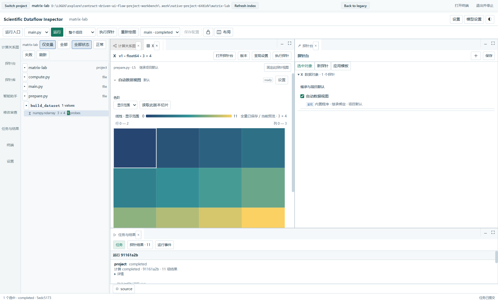
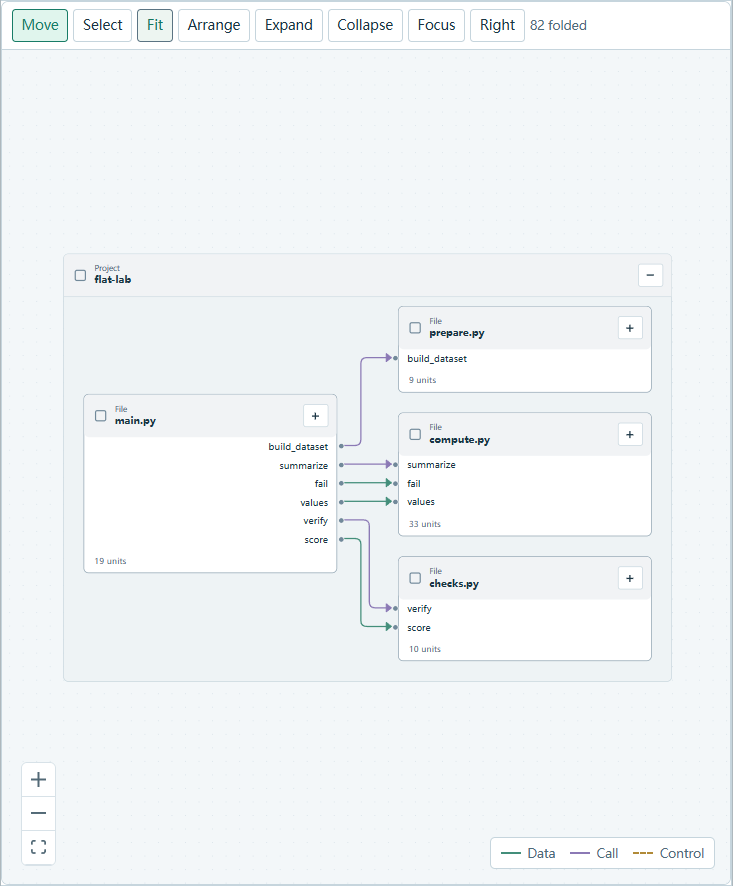
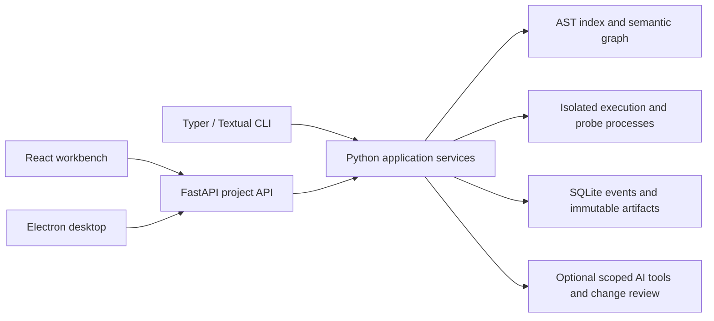

# Scientific Dataflow Inspector

**Understand scientific Python through dataflow graphs, real variable values, and extensible probes.**

Open a Python project. Follow its computations. Inspect matrices and tables. Find where a numerical problem starts.

[简体中文](README.zh-CN.md) · [Quick start](docs/research/projects.md) · [CLI reference](docs/research/cli.md) · [System architecture](docs/research/system-code-architecture.zh-CN.md) · [Validation](docs/release.md)

> **Development candidate · 0.6.0.** The current workbench lives on [`feat/contract-driven-ai-flow`](https://github.com/iyohesohoka646-dotcom/SFA/tree/feat/contract-driven-ai-flow), reviewed in [PR #1](https://github.com/iyohesohoka646-dotcom/SFA/pull/1). `master` contains the earlier SFA code. Use the branch below to try this version; it has not been published to PyPI.



## What you can do

- **Explore a project:** index Python files without importing or executing them; browse folders, functions and variables, then choose a script or `python -m` entry to run.
- **Read the computation:** switch between **Code** structure and **Data** dependencies. Expand one group or one level at a time; named ports, directed connections and relation highlighting make the links traceable.
- **Inspect actual values:** open immutable variable versions with source references, type, shape, matrix/table previews, axes, units and capture coverage. NumPy and pandas are the first built-in adapters.
- **Apply probes:** present, check, interpret or derive data. Reusable templates create independent bindings; disabling a presentation probe removes its view. Compare objects or derive data with parent-input references.
- **Use optional AI:** select a saved provider/model profile, inspect the sending scope and review proposed code changes before applying them. Basic inspection needs no API key.

This is a local research tool for understanding and debugging existing analysis code. Importing a project only parses it; computation, plotting and model calls require explicit actions.

## Try it locally

Use **Python 3.11–3.13** in a virtual environment and Git:

```console
git clone --branch feat/contract-driven-ai-flow https://github.com/iyohesohoka646-dotcom/SFA.git
cd SFA
python -m pip install ".[research,tables]"
cdaf studio --project ./examples/research/projects/matrix-lab
```

The package contains the built Web UI. **Node.js and a model key are not required for normal use.** Optional third-party plotting adapters can be installed with `python -m pip install ".[views]"`.

1. In the workbench, choose **Open folder** and select `examples/research/projects/matrix-lab`. In a browser, use the local folder-path field; the Windows desktop app uses a native folder picker.
2. Open **运行入口 / Run entries**, choose `main.py`, save the entry and click **运行 / Run**. Code runs with the selected scientific interpreter and its dependencies.
3. Expand a file/function in the object browser. Double-click a variable to inspect its saved value; **打开探针台 / Open probe bench** shows its bindings.
4. Change or apply probes, then explicitly run the required computation or replot. Disabling the automatic data-view template removes its presentation bindings.

The [example projects](examples/research/projects/README.md) include flat and `src/` layouts, matrices/tables, and successful/failing paths. For `src/` layouts, install the example package in the selected interpreter as described in that guide.

## A graph you can explore



A click selects; explicit navigation opens source or enters a scope. **Focus** optionally dims unrelated content. Drag a node header to reposition it; **Arrange** aligns blocks and reroutes connections. Hand-positioned layouts and folding state are saved. **Fit** gives an overview; large graphs are explored through local expansion and scope navigation. Panels support docking, resizing, minimize/maximize and saved layouts.

Graph presentation draws on [dbdiagram's detail levels](https://docs.dbdiagram.io/diagram-detail-levels/) and grouped relationships. Static inferred links remain distinct from runtime evidence. See [implementation and checks](docs/research/diagram-presentation.zh-CN.md).

## Web, desktop and CLI

| Entry | Purpose |
| --- | --- |
| `cdaf studio --project PATH` | Open the local browser workbench |
| `cdaf serve --project PATH` | Keep a local service running independently of browser tabs |
| Windows desktop | Same workbench with private Python and a native folder picker; [build instructions](desktop/README.md) |
| `cdaf terminal --project PATH` | Interactive terminal client with `/open`, `/run`, `/vars`, `/probe`, `/model`, `/help` |
| `cdaf workbench project --help` | Project open/index/info/graph/entries/plan/run commands |
| `cdaf observe analysis.py --python PATH --project PATH` | Batch capture using a selected scientific interpreter |
| `cdaf --json research runs --project PATH` | Read saved runs for automation without executing them again |

Closing the final browser tab started by `studio` stops its owned service after a refresh grace period. Closing the desktop window stops its owned backend. Use `serve` for persistent operation. Embedded Python/CLI/Shell terminals are real PTY sessions. [Local deployment](docs/local-deployment.md).

**Model settings** are in the top bar. Save multiple provider-neutral profiles once, then select one for a task or probe. OpenAI-compatible and Anthropic services are supported; credentials use explicit environment/key-vault references. Connection checks and inference checks are separate. Model interpretation needs review. [Model and CLI setup](docs/research/cli.md).

## How it is built



A Python modular monolith shares application services across entry points. React Flow renders graphs, ELK computes layout in a browser Worker, and Dockview manages panels. Python source remains file-based; runtime evidence is version-addressed. [Detailed system/code architecture with diagrams](docs/research/system-code-architecture.zh-CN.md) · [Project protocol](docs/research/project-protocol.md).

## Extend it

| Extension point | Responsibility |
| --- | --- |
| `cdaf.research.adapters` | Capture a native data type and declare fidelity/capabilities |
| `cdaf.research.probes` | Add bounded, read-only analysis/checks |
| `cdaf.research.runners` | Emit the observation protocol from another execution backend |
| Frontend renderer registry | Render another data descriptor/sample |

Probes separate **definitions → templates → bindings → execution → results**. Functional purposes are **present / check / interpret / derive**; implementations may be built-in, custom programs, models, Skills or human judgment. Installing a resource and binding it to data are separate operations. Plugins are explicitly enabled.

[Adapter API](docs/research/adapter-api.md) · [Probe API](docs/research/probe-api.md) · [Point-cloud example](examples/research/custom-adapter.py) · [Custom renderer](web/src/research/PointCloudView.tsx)

## Status and boundaries

- Local Python multi-file projects, script/module entry points, Code/Data graphs, probes, versioned evidence and reviewed multi-file changes are implemented. Windows native acceptance and cross-platform CI are recorded separately in [release evidence](docs/release.md).
- Full capture is opt-in and bounded; default previews/summaries are not the complete dataset. Uncaptured historical values stay unavailable. Execution completion does not imply that quality probes passed.
- Async/generator/dynamic code has explicit coverage limits. GPU, sparse, distributed and non-Python backends have extension boundaries, without built-in support in this candidate. Notebook execution and real-time collaboration are outside this version.
- Local child processes retain the user's file/network permissions. Windows installers are unsigned; macOS/Linux native installers and real external-model effectiveness have not been acceptance-tested for this candidate.
- Historical performance figures are fixture-specific measurements, not production or universal-overhead guarantees. [Performance](docs/research/performance.md) · [Instrumentation](docs/research/instrumentation.md) · [Limitations](docs/research/limitations.md).

## Development and contribution

```console
python -m pip install -e ".[dev,research,tables,views]"
npm ci --prefix web
npm run build --prefix web
python -m pytest -q
npm run test:unit --prefix web
npm run test:e2e --prefix web
```

Browser tests require Playwright's browser dependencies; see [.github/workflows/ci.yml](.github/workflows/ci.yml) for the configured CI environment. Windows browser tests use Edge. Desktop packaging and native acceptance have their own [instructions](desktop/README.md).

[Contributing](CONTRIBUTING.md) · [Migration](docs/research/migration.md) · [Legacy contract workflow](docs/workflow.md) · [Notices](NOTICE.md)

Scientific Dataflow Inspector is the current display name. Repository `SFA`, package `contract-driven-ai-flow`, import `contract_driven_ai_flow`, and CLI `cdaf` remain compatible; `sfa` is a legacy alias. Earlier contract-first architecture workflows remain accessible through the legacy entry.

MIT · Based on SFA. Diagram/dataflow inspiration includes Archify, Hamilton, dbdiagram, drawDB and Easy RD; see the linked implementation notes and third-party notices.
