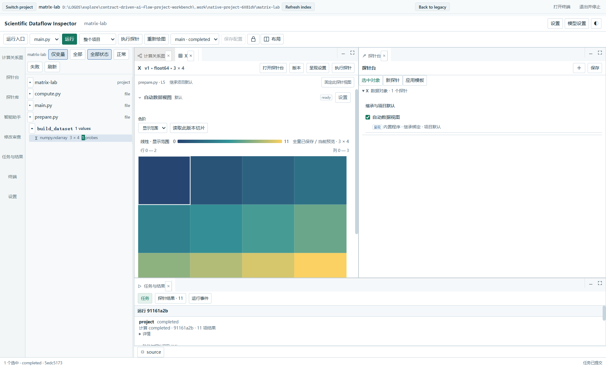
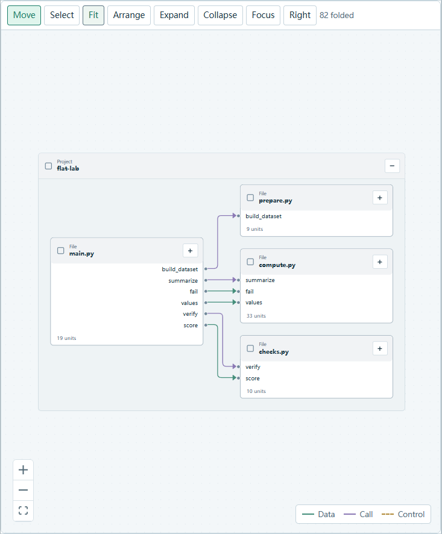
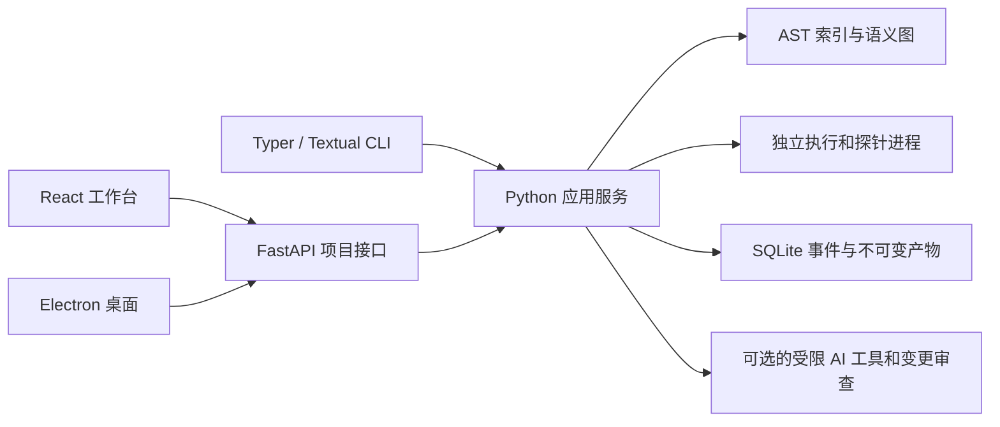

# Scientific Dataflow Inspector · 科研数据流观察器

**用计算关系图、真实变量值和可扩展探针，理解科研 Python 代码。**

打开项目，追踪计算，查看矩阵和表格，找到数值问题最早出现的位置。

[English](README.md) · [快速开始](docs/research/projects.zh-CN.md) · [CLI](docs/research/cli.md) · [系统与代码架构](docs/research/system-code-architecture.zh-CN.md) · [验证记录](docs/release.md)

> **0.6.0 开发候选版。** 当前工作台位于 [`feat/contract-driven-ai-flow`](https://github.com/iyohesohoka646-dotcom/SFA/tree/feat/contract-driven-ai-flow)，通过[草稿 PR #1](https://github.com/iyohesohoka646-dotcom/SFA/pull/1)审查。`master` 仍是较早的 SFA；请使用下方分支安装。本版本尚未发布到 PyPI。



## 可以用它做什么

- **理解整个项目：** 扫描 Python 文件，无需导入或执行项目代码；按目录、文件、函数和变量浏览，再选择脚本或 `python -m` 入口运行。
- **查看计算关系：** Code 展示代码计算结构，Data 展示数据依赖。按块或逐层展开，通过命名端口、有方向的连线和关联高亮追踪输入输出。
- **检查真实数据：** 查看不可变变量版本、对应源码、类型、形状、矩阵／表格、坐标、单位和采集覆盖。NumPy、pandas 是首批内置适配器。
- **配置探针：** 呈现、检验、解释或推导数据；模板生成独立绑定，停用呈现探针就移除对应视图。多对象比较与派生计算保留父输入引用。
- **可选地使用 AI：** 选择已保存的模型服务配置，检查发送范围，审查代码修改提案后再应用。基础观察不需要密钥。

这是面向已有实验和数据分析代码的本地科研工具。导入只解析源码；计算、绘图和模型调用均需明确触发。

## 本地体验

准备 Git 和 **Python 3.11–3.13**，建议使用虚拟环境：

```console
git clone --branch feat/contract-driven-ai-flow https://github.com/iyohesohoka646-dotcom/SFA.git
cd SFA
python -m pip install ".[research,tables]"
cdaf studio --project ./examples/research/projects/matrix-lab
```

发行包自带编译后的 Web UI，**日常使用不需要 Node.js 或模型密钥**。需要第三方绘图库适配时，再安装 `python -m pip install ".[views]"`。

1. 点击 **Open folder**，选择 `examples/research/projects/matrix-lab`。网页版通过本机目录路径打开，Windows 桌面版使用系统文件夹选择器。
2. 打开 **运行入口**，选择 `main.py`，保存后点击 **运行**。程序使用所选科研解释器及其中安装的依赖执行。
3. 在对象浏览器展开文件和函数，双击变量查看保存的数据；点击 **打开探针台** 管理其绑定。
4. 修改或应用探针，再按需执行计算或重绘。停用自动数据视图模板会移除其呈现绑定。

[示例项目](examples/research/projects/README.md)包含普通目录、`src/` 包布局、矩阵／表格，以及成功和失败路径。`src/` 项目应按示例说明先安装到所选解释器。

## 可逐层探索的关系图



单击只选择；显式导航才打开源码或进入范围。**Focus** 可选择淡化无关内容。拖动节点标题调整位置，**Arrange** 自动整理块和排线，手工位置与折叠状态随视图保存。**Fit** 查看总览，大图通过局部展开和进入范围细读。工作区支持拖动标签、分屏调整、缩小、放大及保存布局。

图呈现借鉴 [dbdiagram 的详情等级](https://docs.dbdiagram.io/diagram-detail-levels/)与分组关系。静态推断关系和真实运行证据分别标识。[本轮实现与验证](docs/research/diagram-presentation.zh-CN.md)。

## Web、桌面与 CLI

| 入口 | 用途 |
| --- | --- |
| `cdaf studio --project PATH` | 打开本地浏览器工作台 |
| `cdaf serve --project PATH` | 启动独立于浏览器标签生命周期的本地服务 |
| Windows 桌面程序 | 相同工作台，携带私有 Python 与系统目录选择器；[构建说明](desktop/README.md) |
| `cdaf terminal --project PATH` | 交互终端，支持 `/open`、`/run`、`/vars`、`/probe`、`/model`、`/help` |
| `cdaf workbench project --help` | 项目打开、索引、信息、图、入口、计划和运行命令 |
| `cdaf observe analysis.py --python PATH --project PATH` | 使用指定科研解释器批量采集 |
| `cdaf --json research runs --project PATH` | 读取历史运行供自动化使用，不重复执行 |

关闭 `studio` 启动的最后一个浏览器标签后，所属服务在刷新宽限期结束后停止；关闭桌面窗口也会停止所属后端。需要持续服务时使用 `serve`。内嵌 Python、应用 CLI 和系统 Shell 使用真实 PTY 会话。[部署说明](docs/local-deployment.md)。

顶部 **模型设置** 可一次保存多个通用模型服务配置，随后在任务或探针中选择。支持 OpenAI 兼容接口与 Anthropic，密钥通过明确的环境变量或密钥库引用读取；连接测试和实际推理测试分别记录。模型解释需要核对。[配置与 CLI](docs/research/cli.md)。

## 系统如何组成



Python 模块化单体向各入口提供相同应用服务。React Flow 呈现图形，ELK 在浏览器 Worker 中布局，Dockview 管理面板。源码保留为文件，运行证据绑定相应版本。[图文系统与代码架构](docs/research/system-code-architecture.zh-CN.md) · [项目协议](docs/research/project-protocol.md)。

## 扩展接口

| 扩展点 | 职责 |
| --- | --- |
| `cdaf.research.adapters` | 采集新的原生数据类型，声明能力与数据保真度 |
| `cdaf.research.probes` | 增加有预算边界的只读检查与分析 |
| `cdaf.research.runners` | 从其它执行后端输出相同观察协议 |
| 前端渲染器注册表 | 呈现新的数据描述和样例 |

探针遵循 **定义 → 模板 → 绑定 → 执行 → 结果**。功能分为呈现／检验／解释／推导，实现可使用内置程序、自定义程序、模型、Skill 或人工判断。资源安装与目标绑定分开管理，插件需明确启用。

[适配器 API](docs/research/adapter-api.md) · [探针 API](docs/research/probe-api.md) · [点云适配示例](examples/research/custom-adapter.py) · [渲染器示例](web/src/research/PointCloudView.tsx)

## 当前状态与边界

- 已实现本地 Python 多文件项目、脚本／模块入口、Code／Data 图、探针、版本化证据和可审查的跨文件修改。Windows 原生验收与跨平台 CI 分别记入[发行记录](docs/release.md)。
- 完整采集需显式开启并受预算限制；默认预览、摘要不代表完整数据集。历史未采集值保持不可用；执行完成与质量检查通过分别表示。
- 异步、生成器和动态代码有明确覆盖限制。GPU、稀疏、分布式与非 Python 后端预留扩展边界，当前未内置支持。Notebook 执行和实时多人协作不在本版范围内。
- 本地子进程保留用户的文件与网络权限。Windows 安装包未签名，macOS／Linux 原生安装和真实外部模型效果尚未完成本候选版验收。
- 历史性能数据来自注明条件的夹具，不构成任意程序的开销或生产性能保证。[性能](docs/research/performance.md) · [插桩](docs/research/instrumentation.md) · [限制](docs/research/limitations.md)。

## 开发与贡献

```console
python -m pip install -e ".[dev,research,tables,views]"
npm ci --prefix web
npm run build --prefix web
python -m pytest -q
npm run test:unit --prefix web
npm run test:e2e --prefix web
```

浏览器测试还需 Playwright 浏览器依赖，配置见 [CI 工作流](.github/workflows/ci.yml)；Windows 使用 Edge。桌面打包与原生验收见[桌面说明](desktop/README.md)。

[参与贡献](CONTRIBUTING.md) · [迁移](docs/research/migration.md) · [旧契约工作流](docs/workflow.md) · [第三方说明](NOTICE.md)

Scientific Dataflow Inspector 是当前显示名称。仓库 `SFA`、发行包 `contract-driven-ai-flow`、导入名 `contract_driven_ai_flow` 和 CLI `cdaf` 保持兼容，`sfa` 保留为旧命令别名；早期契约架构工作流仍可通过旧版入口访问。

MIT · 基于 SFA。图与数据流设计参考 Archify、Hamilton、dbdiagram、drawDB 和 Easy RD，具体来源见实现文档及第三方说明。
