# Scientific Dataflow Inspector 架构详解

理解项目代码、运行数据、探针和智能修改如何协作

**代码基准**　0.6.0 · `1caa4ead427625815ee473bc3b9c965b795e0479`

本文对应本地开发候选版，版本号不表示已正式发布。

**核对日期**　2026 年 10 月 14 日

**阅读对象**　使用工具的科研人员，以及继续维护和扩展它的开发者

## 01 先建立一个整体认识

Scientific Dataflow Inspector 是一个在本机运行的 Python 科研代码观察工作台。用户打开项目后，可以查看跨文件计算结构，选择一个入口运行，观察变量在计算中的实际数值，再用探针呈现、检查、解释或推导数据。智能助手使用相同的项目和证据服务，提出需要审查的建议与代码修改。

系统有三条彼此关联的主线。**源码主线**回答“代码中存在什么结构和可能的依赖”；**证据主线**回答“这一次真正执行了什么，采集到了什么”；**探针主线**回答“怎样使用这些对象和证据”。关系图、矩阵和模型解读分别依赖不同来源，不能互相代替。

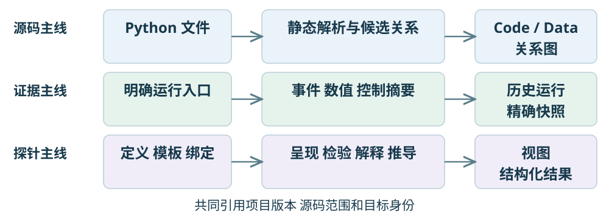

例如，静态图可以识别 `C = Z.T @ Z` 对 `Z` 的依赖。只有运行证据能说明这次 `Z` 的形状和数值；只有有效呈现探针会生成它的矩阵视图。模型给出的解释还应附带它读取的文件和证据版本。

**当前定位。** 主工作区已经扩展到多文件 Python 项目。早期 SFA 的契约、模块编排与生成入口仍作为兼容能力保留；本文以现在的科研工作台为主，不把早期设计文档中的全部能力视为项目模式的默认行为。本文说明当前代码结构，不构成对每个界面操作的重新验收。

源码入口：[S01](#source-s01)、[S02](#source-s02)、[S03](#source-s03)。

## 02 从界面看系统的分工

桌面版和网页版使用同一套 React 工作台。桌面壳增加系统文件夹选择、启动恢复和进程管理。欢迎页负责打开项目和重开最近项目；打开项目本身只登记、扫描与解析，不运行科研程序。首次打开可能创建项目声明与本地索引，因此“只解析”不等于完全不写配置。

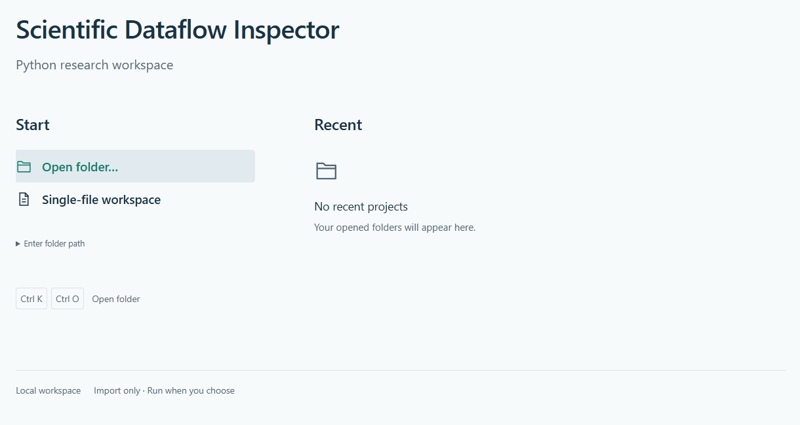

进入项目后，对象浏览器、计算关系图、源码、数据视图、探针台、任务结果、智能助手和终端是独立文档面板。Dockview 管理标签、分屏、缩小、放大、锁定及布局保存。对象选择、进入块和打开文档是不同操作：单击同步选择，显式打开才创建数据或源码页，进入块才改变浏览范围。

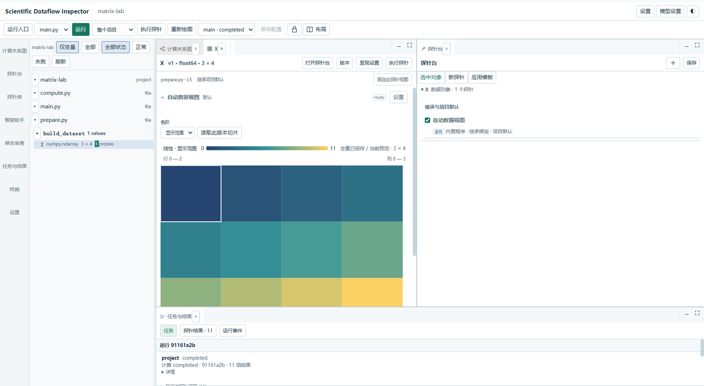

图 2 来自当前提交的项目入口截图；图 3 来自仓库保存的 Windows 项目验收截图，使用测试矩阵项目，裁去顶部机器路径。截图用于识别面板，不代表本次重新运行了安装验收。

源码入口：[S04](#source-s04)、[S05](#source-s05)、[S06](#source-s06)。

## 03 整体架构和部署形态

核心采用模块化单体：一个本地 Python 服务组织项目、索引、任务、证据、探针和智能层；耗时或需要隔离的计算放入工作进程。浏览器负责交互与呈现。桌面壳、Web 和 CLI 共用应用服务，没有三套独立的计算实现。

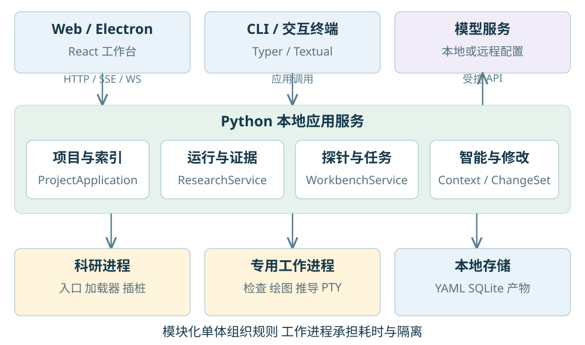

| 层次 | 当前技术 | 主要职责 |
| --- | --- | --- |
| 工作台 | React、TypeScript、Dockview | 面板、选择、配置和审查 |
| 图形与终端 | React Flow、ELK Worker、xterm.js | 图交互、布局、真实终端显示 |
| 本地接口 | FastAPI、HTTP、SSE、WebSocket | 请求、运行事件和终端通信 |
| 应用服务 | Python、Pydantic | 项目身份、冻结计划和一致规则 |
| 工作进程 | Python 子进程、专用 worker | 科研执行、检查、绘图和推导 |
| 桌面与命令行 | Electron、Typer、Textual | 系统集成、批处理和交互命令 |

Python 发行包携带编译后的前端资源。Electron 安装包另带独立 Python 运行时，普通用户无需 Node.js；Node.js 用于开发与构建。本机 API 绑定回环地址并校验会话和来源。项目程序和可信扩展拥有相应用户权限，进程隔离没有提供文件或网络沙箱。

源码入口：[S01](#source-s01)、[S07](#source-s07)、[S08](#source-s08)、[S09](#source-s09)。

## 04 项目 身份和版本为什么要分开

同名变量不代表同一个对象，同一个对象也可能在多次赋值、多次函数调用和多次运行中产生不同值。系统使用项目、文件、逻辑目标、执行作用域和快照等多层引用，避免只凭变量名关联证据。

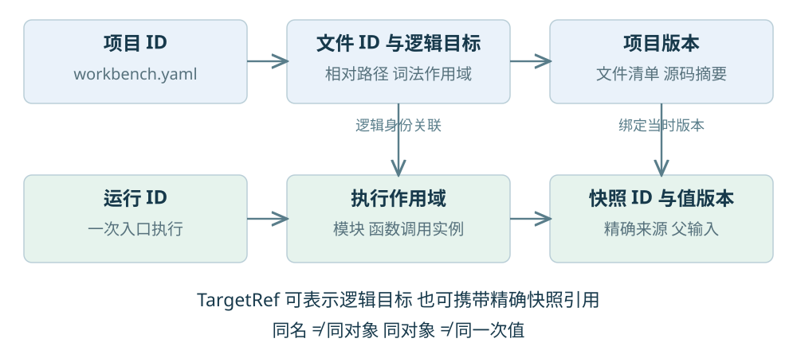

| 记录 | 它回答的问题 | 关键引用 |
| --- | --- | --- |
| `ResearchProject` | 正在分析哪个项目 | 项目 ID、根目录、扫描规则 |
| `SourceUnit` | 这是哪个源码文件 | 文件 ID、相对路径、摘要、分析 ID |
| `ProjectRevision` | 当时有哪些版本的文件 | 版本 ID、文件清单、父版本 |
| `TargetRef` | 探针或选择针对什么 | 逻辑键、块、文件和项目引用 |
| `SnapshotRef` | 这次采到的具体值是什么 | 运行、作用域、版本、来源和父输入 |
| `ExecutionPlan` | 本次明确要执行什么 | 入口、文件清单、配置、探针与目标 |

项目 ID 保存在 `workbench.yaml`，整体移动目录可保留身份。文件 ID 默认由项目 ID 和相对路径生成；它不是对任意重命名都稳定的全局符号 ID。存在两个相同 UUID 的项目副本时，系统会拒绝静默重指向。活跃任务或监听器仍指向旧目录时，迁移根目录也会被阻止。

对象浏览器默认取所选运行中最近实际采集的值。未执行到的最后一条赋值不会成为“最终结果”。历史源码、图和数据绑定历史版本；缺失或脱敏后无法重建的归档会报告缺口，不能拿当前文件补齐。

源码入口：[S02](#source-s02)、[S03](#source-s03)、[S10](#source-s10)、[S11](#source-s11)。

## 05 项目发现和增量索引

项目发现服务识别普通脚本与 `src/` 布局，按包含、排除规则扫描源码。默认避开版本库、虚拟环境、依赖、缓存和构建目录，不通过导入执行代码来推断结构，也不把所有文件拼成一个大源码文档。

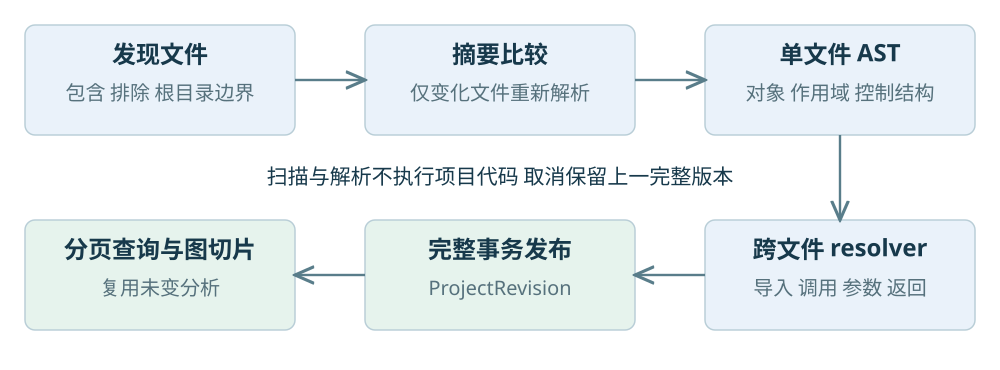

每个文件先计算摘要，再调用单文件 AST 分析，得到对象、作用域、块、计算节点、控制结构和源码范围。项目 resolver 在此基础上建立导入、符号、调用、实参与形参、返回值与接收对象之间的候选关系。相对导入、别名和可静态确定的重导出能够进入索引；动态导入、反射及不确定分派保留未知边界。导入关系可以成环。

用户启用文件监听后，系统采用元数据扫描、防抖和后台索引。变更文件重新解析，摘要未变的文件复用分析记录；删除文件清理当前引用。完整索引在事务成功后发布新版本，取消时保留上一完整版本。单文件语法错误记录在该文件，不妨碍浏览其他文件。

**两个工程边界。** 单文件源码上限为 10 MiB，单文件对象投影上限为 4096。项目索引按文件保存，但跨文件关系仍有版本级重建工作；增量索引不能理解为“所有成本都只与一个文件有关”。大项目总览使用紧凑索引，不必读取所有完整分析。

源码入口：[S10](#source-s10)、[S12](#source-s12)、[S13](#source-s13)、[S14](#source-s14)。

## 06 两类计算图如何生成

系统先建立统一的 `SemanticGraph`，再投影为 Code 和 Data 两种视图。统一图记录块、节点、边、源码范围、关系来源和覆盖说明；前端布局坐标不改变这些语义。

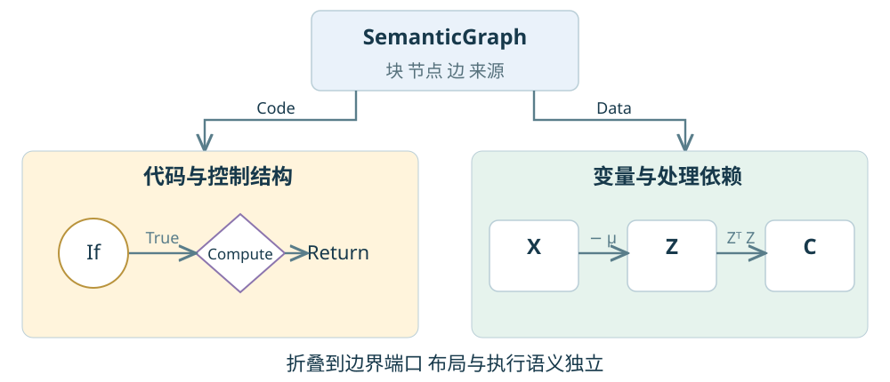

**Code 图**突出文件、函数、条件、循环和计算过程。控制节点使用圆形，计算、调用和合流节点使用菱形，结构容器使用底板。**Data 图**突出变量及其处理依赖。两种图共享源码定位与选中集合，但展示对象和关系不同。跨文件候选关联主要来自静态解析；它们不等价于完整的别名分析、所有副作用分析或每一次实际调用追踪。

折叠时，下级关系汇总到边界端口，保留方向、类别、数量及原始关系 ID。项目、目录、文件和函数可逐层进入与返回；默认折叠控制可见规模，省略数量明确显示。运行状态和有限控制摘要叠加在结构上，系统没有第三套独立“执行图”。

ELK 在 Worker 中根据真实尺寸、端口和嵌套块执行分层、正交布线。自动整理处理位置与连线，不改代码。选择、淡化和数值更新不应触发重新布局；相机和拖动位置按项目、版本、范围与视图保存。布局优化有规则和约束，但不保证任意动态程序都能生成一张无交叉的图。

源码入口：[S11](#source-s11)、[S15](#source-s15)、[S16](#source-s16)、[S17](#source-s17)。

## 07 一次运行怎样产生证据

运行配置只描述意图，包括脚本或模块入口、参数、工作目录、解释器引用和环境引用。编译计划时冻结项目版本、源码清单、运行配置、范围和探针调用。之后改变界面选择不会改变已经提交的任务。

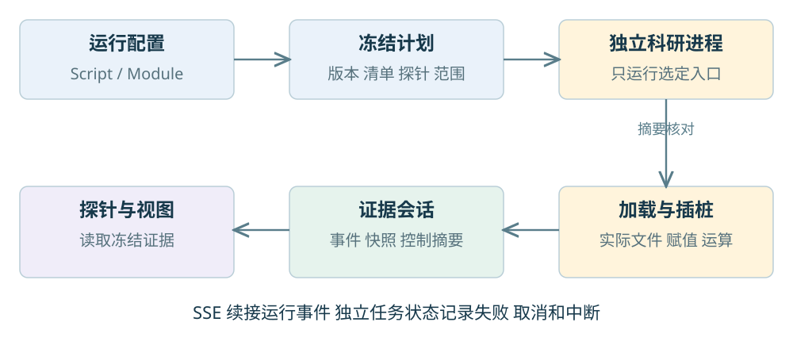

独立科研进程只执行指定入口。项目运行器包装标准 Python 源码加载器，对实际加载、位于项目内且列入冻结清单的源码插桩。脚本和模块入口保留各自的参数、包信息、相对导入及模块缓存行为。索引中存在文件不代表运行时加载过它；实际加载文件另有有界清单和覆盖记录。

插桩将赋值、运算与函数作用域关联到事件和快照，条件与循环产生累计摘要。循环次数指循环体进入次数，另记自然结束、提前退出、异常和不完整状态。强制终止前的计数不能冒充完整结果。热路径更新计数，细节与发布频率受预算限制。

入口和依赖文件的摘要在执行前及加载时复核。变化产生版本冲突，不能把混合源码标为同一完整版本。标准库、第三方包、自定义加载器、异步和生成器存在明确覆盖边界；用户程序仍按原行为运行。自动追踪不会递归扩展到用户启动的其他子进程内部。

源码入口：[S18](#source-s18)、[S19](#source-s19)、[S20](#source-s20)。

## 08 数据采集 精度和运行状态

采集层将活对象转为版本化描述符、有界样例、统计和可选完整产物。探针消费这些冻结证据，不直接拿到科研进程里的活变量。未知类型仅保留安全的类型信息；不会为了显示而随意调用对象的 `repr`、数组转换或计算方法。

| 采集级别 | 保存重点 | 可以支持的结论 |
| --- | --- | --- |
| `metadata` | 类型、形状、后端及能力 | 形状和类型检查；不说明全部数值 |
| `summary` 默认 | 有界统计和预览 | 说明统计覆盖；样本不能替代总体 |
| `sample` | 有界样例 | 局部探索与绘图；持续标记覆盖 |
| `full` | 预算内的完整历史产物 | 支持相应全量检查和联合推导 |

描述符是 `ValueDescriptor`，一次值证据是 `SnapshotRef`，运算记录是 `OperationRecord`，传输与存储单元是带序号的 `ObservationEvent`。每份快照还记录 `exact / sampled / metadata_only`、截断、脱敏、来源和父输入。完整数值产物使用禁止 pickle 的 NPY；完整表格产物依赖可选 PyArrow。

**状态要分别读。** 科研程序可能执行完成，但有限值检查失败；也可能程序结果正确，而观察器故障导致采集不完整。样本中出现 NaN 足以构成失败见证，样本没有 NaN 却不能证明所有未采集元素都正常。错误、未知和未采集不能合并为通过。

运行期检查可配置继续、暂停或取消。探针产生只读结果，独立控制策略在受控边界处理动作；依赖阻断检查却得到错误或未知时暂停，等待用户决定。回看或重新绘制历史证据不会重新触发原计算控制。

默认预览最多 1024 单元、统计最多 4096 元素、控制明细最多 512 条；队列最多 2048 事件或 8 MiB；完整产物单个最多 64 MiB、每次运行最多 256 MiB。这些是当前 `CapturePolicy` 默认值与预算边界，不是性能测量结果。敏感字段在归档、浏览器传输和模型上下文之前脱敏。

源码入口：[S03](#source-s03)、[S20](#source-s20)、[S21](#source-s21)、[S22](#source-s22)。

## 09 探针 定义 模板和绑定

“探针是什么”“把哪些探针一起使用”“应用到谁”“这次具体怎样执行”是四个问题。当前实现分别用定义、模板、绑定实例和已解析调用表达，最后生成有明确来源的结果。

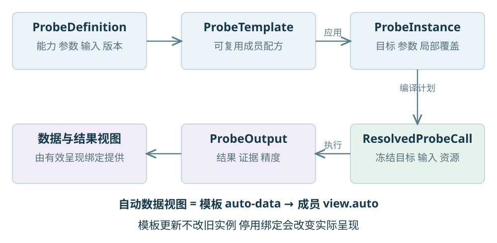

`ProbeDefinition` 声明用途、输入模式、兼容目标、参数 Schema、证据需求和执行入口。单个探针可以直接从定义创建绑定，无需先做模板。`ProbeTemplate` 是可复用配方，每个成员引用一个定义并保存参数。应用模板生成 `ProbeInstance`，冻结自己的成员参数并记录模板来源；以后编辑模板不会静默改写已经应用的实例。

`ScopeSelector` 表达当前选择、已进入块或整个项目。计划解析范围、去重目标，并生成 `ResolvedProbeCall`，冻结定义、参数、输入角色、数据语义和资源版本。一次运行的精确输入再关联到快照，输出成为 `ProbeOutput`。

**自动数据视图是一份模板。** 新项目默认应用它，其中的 `view.auto` 根据数据类型选择内置呈现。停用或删除有效呈现绑定后，对象基本身份仍可见，矩阵与表格应消失；刷新、重跑或新值版本不会自动恢复删除配置。关闭数据标签仅关闭界面，不停用探针。

保存绑定本身不计算。执行探针或重新绘图会冻结当前配置，使用选中历史运行的证据，不重新执行实验入口。历史数据不完整或产物过期时，需要明确补采集，新建一次运行。

源码入口：[S23](#source-s23)、[S24](#source-s24)、[S25](#source-s25)、[S26](#source-s26)。

## 10 探针的分类和组合计算

探针管理采用三个独立维度：**作用对象、功能用途、实现方式**。分类不决定底层数据格式；同一种实现可以服务多个用途，同一份定义可以支持多种目标。

| 维度 | 当前表达 | 读法 |
| --- | --- | --- |
| 对象 | 数据、计算单元、函数、控制块、文件、项目、文件夹、支流类型 | 对谁操作；支流的交互编辑仍留扩展接口 |
| 用途 | 呈现 `view`、检验 `check`、解释 `interpret`、推导 `derive` | 希望得到什么结果 |
| 实现 | 内置、自定义程序、模型、Skill、人工判断 | 由什么机制完成 |

呈现包括数值、表格、矩阵、第三方绘图和比较；检验包括形状、类型、有限值、结构与耗时；解释使用模型、Skill 或已有说明机制；推导产生新数据。Skill 是实现形式，不是与呈现、检验并列的第五种用途。

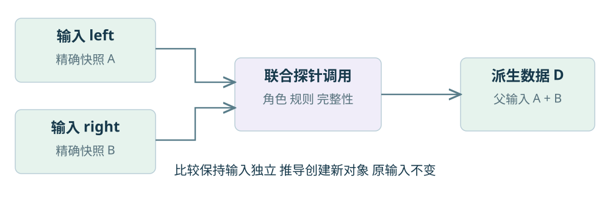

并排比较保持输入独立，可以共享色阶和联动缩放；关系分析需要区分“已有计算依赖”和“另行计算的统计关系”。相关系数属于派生计算，不代表因果关系。计算组合按显式角色连接输入，当前内置逐元素、矩阵乘法、聚合、相关和表格连接。

联合推导检查形状、类型、坐标、缺失值规则和所需完整性，默认同次运行；广播、跨运行和按位置对齐需要明确选项。输入不足时报告诊断，预览不会冒充全量。`DerivedData` 记录全部父输入、摘要、算子和参数，生成新快照，可继续绑定探针；保存分析时同时保留必要父产物。

源码入口：[S23](#source-s23)、[S27](#source-s27)、[S28](#source-s28)。

## 11 扩展接入与呈现自定义

扩展接入与使用实例分开管理。资源清单声明 ID、版本、依赖、入口、支持类型、输入角色、参数 Schema、证据需求和输出能力。导入先成为草案，校验与审查后启用；资源更新和已有绑定不是同一个动作。

| 扩展边界 | 提供的接口 | 当前实例 |
| --- | --- | --- |
| 数据适配器 | `supports / describe / capture` | 标量、NumPy、pandas、自定义点云示例 |
| 检查插件 | `evaluate(context)` | 内置科学检查、自定义探针示例 |
| 运行器 | 版本化事件与运行控制 | Python 运行器、独立运行器注册接口 |
| 前端渲染器 | `supports(descriptor)` 与组件 | 矩阵、表格、点云等；需重新构建前端 |
| 工作台资源 | 清单、参数、入口与版本 | 自定义程序、绘图适配、Skill |

公开绘图目录包含 Matplotlib、Seaborn、Plotly、Altair 的已定义适配能力。工具管理检查安装状态、管理托管绘图环境并读取方法元数据；“机器上安装了一个包”不会自动赋予任意函数探针语义。AI 可以辅助提出适配草案，但仍需清单、兼容性与启用检查。前端不从网络直接执行任意 JavaScript 扩展。

矩阵的数值格式、行列名、坐标、轴含义、单位，以及表格列语义和曲线轴映射属于共享数据语义与呈现参数。长度与维度必须匹配；程序声明、用户设置和模型建议分别保留来源。渲染器消费同一语义，不能支持的参数应明确不可用。

扩展的四层可以独立增加。新增张量后端通常先实现数据适配器和证据规则，再注册需要的检查与呈现。GPU、稀疏和延迟计算不会因为存在注册接口就自动完成设备传输、致密化或物化；这些后端目前没有通用内置覆盖。

**设置的继承。** 通用偏好按内置默认、用户默认、项目覆盖合并，并记录来源与版本。探针库的定义默认值仅初始化新绑定；模板应用和绑定保存各自参数，局部目标覆盖最后生效。因此修改默认值不会悄悄改变已有实验配置。

源码入口：[S21](#source-s21)、[S22](#source-s22)、[S29](#source-s29)、[S30](#source-s30)、[S48](#source-s48)。

## 12 智能层怎样理解环境

模型服务是本机保存的配置，项目与探针选择配置名，不重复填写服务和密钥。当前协议包括离线模式、OpenAI 兼容接口与 Anthropic；没有默认指定 DeepSeek。凭据通过系统凭据库或环境引用获取，项目配置只保存引用。

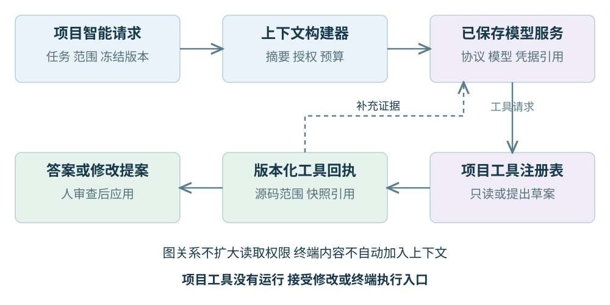

每个项目智能请求绑定不可变的项目 ID 和版本。初始上下文提供文件目录摘要、入口、当前范围、读取授权和工具目录；模型按需搜索符号、查看引用、读取源码片段、查询快照和获取探针目录。工具返回文件、范围、摘要与版本，便于核对结论依据。

上下文构建器和工具注册表按任务创建，不共享可变的“当前请求”。预算限制输入输出、步骤、调用次数、读取次数和总字节数，并去重、截断和记录工具回执。图中的调用或包含关系仅是检索线索，不扩大读取授权；终端内容不自动进入上下文。样例由独立策略控制，并先脱敏。

项目工具目前是只读或创建待审查提案：`project.describe`、`symbols.search`、`references.find`、`source.read`、`evidence.describe`、`probe.catalog`、`probe.suggest`，代码角色另有 `changes.propose`。这套工具没有运行、接受修改或终端执行入口，即使策略字段存在执行许可，也不能绕过项目层工具边界。

离线逻辑与受控 HTTP 工具循环已有测试。用户已选择真实模型稍后测试，本文不宣称任一外部模型的科研解释、问题定位或修改质量已经验收。

源码入口：[S31](#source-s31)、[S32](#source-s32)、[S33](#source-s33)、[S34](#source-s34)。

## 13 跨文件修改 审查和恢复

模型生成的内容先形成 `ProjectChangeSet`，逐文件记录修改前后摘要、操作、差异和诊断。支持项目内新建、修改与受约束格式调整，不自动删除或重命名文件。源码建议与已应用源码有不同状态。

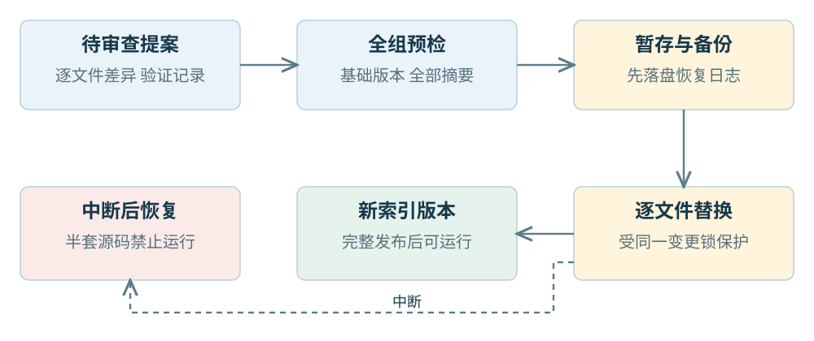

审查展示逐文件差异、受影响引用、导入变化与检查记录。“通过”“失败”“未运行”“未验证”分别保留，语法通过不等于科研结果正确。纯格式提案要求 AST、注释和语句顺序保持一致；允许排版改善，不能借格式调整重新安排计算逻辑。

接受时先复核基础版本和全部文件摘要。任一文件冲突，整组修改都不能按旧版本应用。写入前保存私有原文、暂存文件、备份和持久恢复日志，再逐文件替换；索引发布使用同一项目变更锁，避免发布半套代码。多文件文件系统写入不具备“所有文件同时原子替换”的保证，因此必须有恢复流程。

中断后进入 `recovery_required`，阻止运行、索引和智能请求使用半套源码。恢复处理实际写入状态并记录结果。回滚生成新的待审查提案，不能直接覆盖后续用户编辑。接受修改也不会自动运行实验。

自动改善代码书写结构只能在这些边界内提出建议。图的自动整理通常应优先使用布局层；需要改变函数组织、抽取代码或调整控制结构时，已经属于真实代码变更，必须单独验证语义。

源码入口：[S35](#source-s35)、[S36](#source-s36)、[S37](#source-s37)。

## 14 定义 本机设置和运行证据的存储

配置与运行产物分开保存。项目作者定义适合版本管理；索引、历史运行、缓存和绘图位于 `.cdaf/`。本机解释器、环境值和模型凭据还要与项目可共享内容分开。

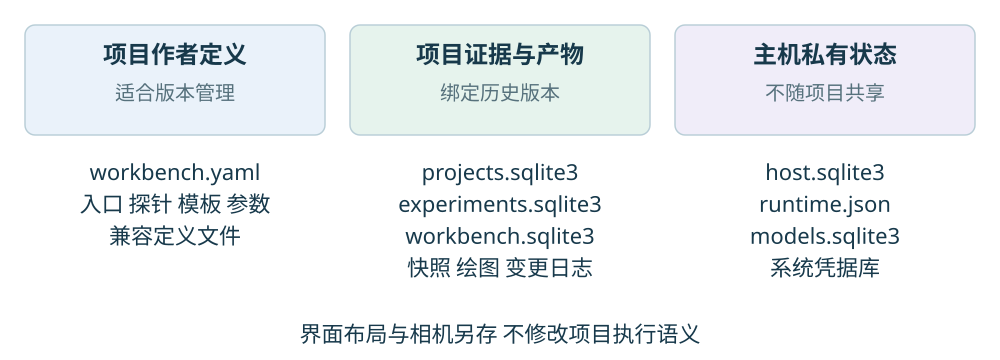

| 位置 | 主要内容 | 归属 |
| --- | --- | --- |
| 项目 `workbench.yaml` | 项目声明、入口、探针、模板、参数 | 作者配置 |
| 项目 `projects.sqlite3` | 文件索引、版本清单、关系、源码归档 | 项目证据与索引 |
| 项目 `experiments.sqlite3` | 运行、事件、快照、运算与控制摘要 | 运行证据 |
| 项目 `workbench.sqlite3` | 计划、任务、探针输出及资源记录 | 工作台状态 |
| 项目 `projects/manifests/` | 冻结运行源码清单 | 精确版本 |
| 项目 `project-changes/` | 提案原文、备份、日志与恢复状态 | 私有修改记录 |
| 主机 `host.sqlite3` | 已登记项目与根目录 | 最近项目注册表 |
| 主机 `.cdaf/runtime.json` 与快照 | 解释器、环境值及其冻结引用 | 本机私有配置 |
| 主机 `.cdaf/settings/models.sqlite3` | 模型配置与调用记录；无明文密钥 | 本机模型设置 |
| 浏览器本地存储 | 面板布局、相机、主题等 | 界面状态 |

表中未带 `.cdaf` 的数据库和目录均位于对应根目录的 `.cdaf/research/` 下。“主机”指启动服务时使用的管理目录，可能与某个项目目录相同。实际产物还包含源码归档、数值或表格文件和绘图目录；SQLite 保存引用和结构化记录，不把所有数据塞进一条 JSON。

`.cdaf/studio.json` 保存启动会话信息，包含敏感令牌，不能作为共享文档或示例上传。旧单文件证据保留旧身份，不因打开父目录就自动重新归属。清理缓存、过期产物与删除项目定义必须保持不同范围。

源码入口：[S10](#source-s10)、[S14](#source-s14)、[S38](#source-s38)、[S39](#source-s39)、[S40](#source-s40)。

## 15 前端状态 终端和应用生命周期

项目界面通过不可变的项目专属客户端发请求，路径包含项目 ID。`ProjectHost` 管理登记、最近项目与索引；`ProjectWorkbench` 组合面板；`useProjectWorkbench` 协调配置、运行、任务和证据。服务端不依赖可被其他窗口改写的全局“当前项目”。

选择集合与浏览范围分开。运行事件经 SSE 按序号续接，前端批量合并更新；任务记录轮询反映后台阶段。项目切换时解除旧订阅并阻止迟到响应污染新界面，原项目任务仍由它自己的服务管理。布局、相机和语义模型分别保存。

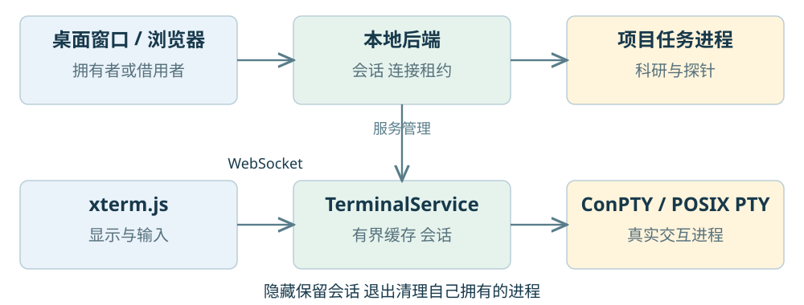

内嵌终端由 xterm.js 显示，WebSocket 连接后端终端服务。Windows 使用 ConPTY，macOS/Linux 使用系统 PTY；它是真实交互进程，可以运行 CLI、Python 和系统 Shell。隐藏或缩小保留会话，显式结束才终止进程；启动错误和状态需要可见，缓存有上限。

桌面壳通过受限 preload IPC 暴露目录选择和生命周期能力。启动失败进入恢复页，窗口关闭时清理自己拥有的后端与子进程。浏览器模式使用连接租约与断连宽限，容忍刷新；关闭最后一个连接后，按拥有服务的模式退出。借用已有服务的窗口不能顺带终止别人的服务。长期服务模式有独立生命周期。

源码入口：[S04](#source-s04)、[S05](#source-s05)、[S08](#source-s08)、[S41](#source-s41)、[S42](#source-s42)、[S43](#source-s43)。

## 16 用三文件矩阵实验串起全流程

仓库的 `examples/research/projects/matrix-lab` 只有三个源码文件，足以展示项目级闭环。`prepare.py` 的 `build_dataset` 构造 3 × 4 矩阵；`compute.py` 的 `covariance` 计算均值、中心化矩阵与协方差；`main.py` 负责入口、可选 NaN 注入及结果输出。

```text
main.py
  X = build_dataset()        → prepare.py
  if options.nan: X[1,2] = NaN
  C = covariance(X)          → compute.py

compute.py
  mu = X.mean(axis=0)
  Z  = X - mu
  C  = Z.T @ Z / (X.shape[0] - 1)
```

索引阶段识别跨文件调用、参数与返回关系；运行阶段记录真正加载的文件和各作用域的值。这里的 `prepare.py::X`、`main.py::X` 与函数参数 `compute.py::X` 保留各自身份，不能仅因同名就视为一个观察对象。参数和返回关系提供关联线索，快照提供这次的数值证据。

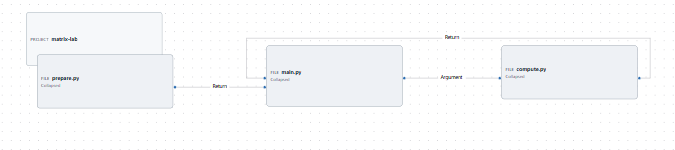

正常输入为 `0…11` 按 3 × 4 排列，均值为 `[4,5,6,7]`，中心化后每列是 `[-4,0,4]`，最终 4 × 4 协方差矩阵各项均为 16。这是对该固定示例公式的计算说明。通过 `--nan` 注入异常时，程序可能正常结束，但相应数据的有限值探针应报告失败；执行完成与质量通过必须分别观察。

用户可以再给 `C` 绑定数值表和对称性检查，显式执行历史证据探针；完整输入仍在时无需重跑实验。停用自动视图模板后，矩阵图不应由其他隐式路径补回。该例同时连接了源码、版本、值、探针和视图。

源码入口：[S44](#source-s44)、[S45](#source-s45)、[S46](#source-s46)。

## 17 接口和继续开发的落点

项目 HTTP 接口统一在 `/api/v1/research/projects/{project_id}/…`，提供树、对象、符号、引用、源码、分析、图切片、入口、计划、任务、运行、智能与修改审查。写入和执行计划携带预期版本，过期请求返回明确冲突。Pydantic 模型生成 JSON Schema，再生成前端 TypeScript 类型。

CLI 的项目命令使用同一个 `ProjectApplication`，命令之间通过项目身份、发布版本和冻结计划衔接。下例中的路径与 ID 是占位符；`run` 执行已冻结计划，不能把 `plan` 当作已经运行。

```powershell
cdaf --json workbench project open PROJECT_PATH
cdaf --json workbench project index --project PROJECT_PATH
cdaf --json workbench project entries --project PROJECT_PATH
cdaf --json workbench project plan --project PROJECT_PATH --entry ENTRY_ID
cdaf --json workbench project run --project PROJECT_PATH --plan PLAN_ID
cdaf --json workbench project graph --project PROJECT_PATH --view data
```

| 想增加的能力 | 优先修改的边界 | 应保持的约束 |
| --- | --- | --- |
| 新科学数据类型 | 数据适配器与描述符 | 有界、只读、标明精度 |
| 新检查或分析 | 探针定义、输入角色与 worker | 冻结证据、超时、结构化结果 |
| 新图形呈现 | 渲染器或绘图适配器 | 来自有效探针，不绕过绑定 |
| 新项目语法关系 | 单文件分析与项目 resolver | 来源、作用域与未知边界 |
| 新智能服务 | ProviderProfile 与传输实现 | 凭据引用、预算、工具回执 |
| 新编辑能力 | ProjectChangeSet 与验证恢复 | 全组复核、人审查、可恢复 |

项目应用层目前复用并扩展单文件 `WorkbenchService`，前端也复用探针、任务和布局组件。这使行为能够共用，但大型服务与组合组件仍需要持续拆分职责；“模块化单体”不代表每个文件已经同样小巧。新增后端应进入相应接口，避免把类型分支、模型调用和图布局继续堆入主组件。

源码入口：[S01](#source-s01)、[S07](#source-s07)、[S18](#source-s18)、[S47](#source-s47)。

## 18 当前覆盖与明确边界

以下区分来自当前代码和仓库验证记录，避免把扩展接口当成已完成的通用功能。

| 范围 | 当前状态 | 使用时应知道的限制 |
| --- | --- | --- |
| Python 多文件、脚本与模块入口 | 已实现 | 保留真实导入环境，不自动修复环境 |
| 目录树、跨文件查询、Code/Data 图 | 已实现 | 静态推断存在动态与别名边界 |
| 版本化运行、快照、控制摘要 | 已实现 | 异步、生成器、自定义加载器可能部分覆盖 |
| 探针、模板、联合推导与资源管理 | 已实现 | 完整数据、坐标和适配能力有前提 |
| 项目智能上下文与跨文件提案 | 已实现并有受控测试 | 真实外部模型效果仍待验证 |
| Windows 桌面、真实 PTY 与安装入口 | 仓库有实际验证记录 | 本文没有重新执行安装回归；安装包未签名 |
| macOS/Linux 核心 | 有跨平台 CI 记录 | 不等同于完成当地桌面安装与人工使用验收 |
| 自定义数据、探针与运行器 | 有注册协议和示例 | 可信扩展；不提供操作系统沙箱 |
| Notebook、多语言、多根、分布式 | 本版未纳入 | 不能由预留类型推断为可用 |
| GPU、稀疏与延迟对象通用支持 | 尚无通用内置适配 | 需要独立实现物化与预算规则 |
| 用户圈定重叠计算支流 | 类型和提供器留接口 | 不宣称已有完整编辑工作区 |

**性能依靠范围和预算控制。** 默认图约束约 350 个可见单元，按块折叠与分页继续探索；布局移出主线程；采集、控制明细、终端输出和后台任务有界。项目应用当前默认 3 个后台线程、16 个任务准入槽和 4 个共享计算预算槽；检查子进程池另有自己的限额，不能把这些数相加当作用户任务并发保证。

这些机制减小观察开销，不提供“零开销”承诺，也没有把科研程序变成分布式生产调度系统。本次交付核对了源码并检查文档渲染，没有为文档另跑整套软件性能、安装和模型验收。需要评价某项实用效果，应回到对应版本的测试与实际入口。

验证与扩展说明：`docs/research/project-protocol.md`、`projects.zh-CN.md`、`adapter-api.md`、`probe-api.md`、`docs/assets/project-entry-validation.json`、`docs/release.md`。

## 19 源码阅读索引

下面的链接固定到本文核对提交，便于以后代码变化时继续核对。阅读顺序建议为应用服务、对象模型、项目索引与执行，再按需要阅读探针、智能、前端与桌面。`research/`、`settings/` 和 `application/` 开头的路径相对 `src/contract_driven_ai_flow/`；其余相对仓库根目录。表中的入口不是文件内全部职责清单。

<!-- SOURCE_INDEX -->

| 编号 | 源码入口 | 主要职责 |
| --- | --- | --- |
| <a id="source-s01"></a>S01 | [research/projects/application.py:26](https://github.com/iyohesohoka646-dotcom/SFA/blob/1caa4ead427625815ee473bc3b9c965b795e0479/src/contract_driven_ai_flow/research/projects/application.py#L26) | 按项目管理服务与预算 |
| <a id="source-s02"></a>S02 | [research/projects/models.py:94](https://github.com/iyohesohoka646-dotcom/SFA/blob/1caa4ead427625815ee473bc3b9c965b795e0479/src/contract_driven_ai_flow/research/projects/models.py#L94) | 项目 文件和版本 |
| <a id="source-s03"></a>S03 | [research/models.py:19](https://github.com/iyohesohoka646-dotcom/SFA/blob/1caa4ead427625815ee473bc3b9c965b795e0479/src/contract_driven_ai_flow/research/models.py#L19) | 来源 描述符 快照和事件 |
| <a id="source-s04"></a>S04 | [web/src/research/projects/ProjectWorkbench.tsx:74](https://github.com/iyohesohoka646-dotcom/SFA/blob/1caa4ead427625815ee473bc3b9c965b795e0479/web/src/research/projects/ProjectWorkbench.tsx#L74) | 项目界面组合 |
| <a id="source-s05"></a>S05 | [web/src/research/projects/ProjectHost.tsx:81](https://github.com/iyohesohoka646-dotcom/SFA/blob/1caa4ead427625815ee473bc3b9c965b795e0479/web/src/research/projects/ProjectHost.tsx#L81) | 项目入口与切换 |
| <a id="source-s06"></a>S06 | [web/src/research/workspace/DockWorkspaceShell.tsx:157](https://github.com/iyohesohoka646-dotcom/SFA/blob/1caa4ead427625815ee473bc3b9c965b795e0479/web/src/research/workspace/DockWorkspaceShell.tsx#L157) | 可调整文档布局 |
| <a id="source-s07"></a>S07 | [research/routes.py:279](https://github.com/iyohesohoka646-dotcom/SFA/blob/1caa4ead427625815ee473bc3b9c965b795e0479/src/contract_driven_ai_flow/research/routes.py#L279) | 本地服务组装 |
| <a id="source-s08"></a>S08 | [desktop/src/main.cjs:1](https://github.com/iyohesohoka646-dotcom/SFA/blob/1caa4ead427625815ee473bc3b9c965b795e0479/desktop/src/main.cjs#L1) | 桌面进程和启动恢复 |
| <a id="source-s09"></a>S09 | [pyproject.toml:5](https://github.com/iyohesohoka646-dotcom/SFA/blob/1caa4ead427625815ee473bc3b9c965b795e0479/pyproject.toml#L5) | 包依赖 版本和命令入口 |
| <a id="source-s10"></a>S10 | [research/projects/service.py:56](https://github.com/iyohesohoka646-dotcom/SFA/blob/1caa4ead427625815ee473bc3b9c965b795e0479/src/contract_driven_ai_flow/research/projects/service.py#L56) | 登记 索引和项目版本 |
| <a id="source-s11"></a>S11 | [research/workbench/semantic_models.py:14](https://github.com/iyohesohoka646-dotcom/SFA/blob/1caa4ead427625815ee473bc3b9c965b795e0479/src/contract_driven_ai_flow/research/workbench/semantic_models.py#L14) | 目标 块 节点和边 |
| <a id="source-s12"></a>S12 | [research/projects/discovery.py:13](https://github.com/iyohesohoka646-dotcom/SFA/blob/1caa4ead427625815ee473bc3b9c965b795e0479/src/contract_driven_ai_flow/research/projects/discovery.py#L13) | 有界源码发现 |
| <a id="source-s13"></a>S13 | [research/projects/resolver.py:325](https://github.com/iyohesohoka646-dotcom/SFA/blob/1caa4ead427625815ee473bc3b9c965b795e0479/src/contract_driven_ai_flow/research/projects/resolver.py#L325) | 跨文件候选关系 |
| <a id="source-s14"></a>S14 | [research/projects/store.py:12](https://github.com/iyohesohoka646-dotcom/SFA/blob/1caa4ead427625815ee473bc3b9c965b795e0479/src/contract_driven_ai_flow/research/projects/store.py#L12) | 按文件索引与归档 |
| <a id="source-s15"></a>S15 | [research/projects/queries.py:100](https://github.com/iyohesohoka646-dotcom/SFA/blob/1caa4ead427625815ee473bc3b9c965b795e0479/src/contract_driven_ai_flow/research/projects/queries.py#L100) | 分页对象与图查询 |
| <a id="source-s16"></a>S16 | [web/src/research/projects/graphPresentation.ts:109](https://github.com/iyohesohoka646-dotcom/SFA/blob/1caa4ead427625815ee473bc3b9c965b795e0479/web/src/research/projects/graphPresentation.ts#L109) | Code Data形状和端口 |

### 源码索引续表

| 编号 | 源码入口 | 主要职责 |
| --- | --- | --- |
| <a id="source-s17"></a>S17 | [web/src/graph-semantic-layout.ts:62](https://github.com/iyohesohoka646-dotcom/SFA/blob/1caa4ead427625815ee473bc3b9c965b795e0479/web/src/graph-semantic-layout.ts#L62) | 嵌套 正交布局 |
| <a id="source-s18"></a>S18 | [research/projects/workbench.py:52](https://github.com/iyohesohoka646-dotcom/SFA/blob/1caa4ead427625815ee473bc3b9c965b795e0479/src/contract_driven_ai_flow/research/projects/workbench.py#L52) | 项目冻结计划与执行 |
| <a id="source-s19"></a>S19 | [research/agent/project_runner.py:149](https://github.com/iyohesohoka646-dotcom/SFA/blob/1caa4ead427625815ee473bc3b9c965b795e0479/src/contract_driven_ai_flow/research/agent/project_runner.py#L149) | 标准加载器包装 |
| <a id="source-s20"></a>S20 | [research/agent/control_observation.py:10](https://github.com/iyohesohoka646-dotcom/SFA/blob/1caa4ead427625815ee473bc3b9c965b795e0479/src/contract_driven_ai_flow/research/agent/control_observation.py#L10) | 控制摘要与计数 |
| <a id="source-s21"></a>S21 | [research/agent/adapters.py:24](https://github.com/iyohesohoka646-dotcom/SFA/blob/1caa4ead427625815ee473bc3b9c965b795e0479/src/contract_driven_ai_flow/research/agent/adapters.py#L24) | 数据描述与有界采集 |
| <a id="source-s22"></a>S22 | [research/agent/budget.py:6](https://github.com/iyohesohoka646-dotcom/SFA/blob/1caa4ead427625815ee473bc3b9c965b795e0479/src/contract_driven_ai_flow/research/agent/budget.py#L6) | 采集默认预算 |
| <a id="source-s23"></a>S23 | [research/workbench/models.py:83](https://github.com/iyohesohoka646-dotcom/SFA/blob/1caa4ead427625815ee473bc3b9c965b795e0479/src/contract_driven_ai_flow/research/workbench/models.py#L83) | 定义 模板 绑定 计划与结果 |
| <a id="source-s24"></a>S24 | [research/workbench/bindings.py:96](https://github.com/iyohesohoka646-dotcom/SFA/blob/1caa4ead427625815ee473bc3b9c965b795e0479/src/contract_driven_ai_flow/research/workbench/bindings.py#L96) | 有效绑定与呈现 |
| <a id="source-s25"></a>S25 | [research/workbench/planning.py:23](https://github.com/iyohesohoka646-dotcom/SFA/blob/1caa4ead427625815ee473bc3b9c965b795e0479/src/contract_driven_ai_flow/research/workbench/planning.py#L23) | 冻结范围和探针调用 |
| <a id="source-s26"></a>S26 | [research/workbench/rendering.py:18](https://github.com/iyohesohoka646-dotcom/SFA/blob/1caa4ead427625815ee473bc3b9c965b795e0479/src/contract_driven_ai_flow/research/workbench/rendering.py#L18) | 探针计算与绘图输出 |
| <a id="source-s27"></a>S27 | [research/workbench/catalog.py:20](https://github.com/iyohesohoka646-dotcom/SFA/blob/1caa4ead427625815ee473bc3b9c965b795e0479/src/contract_driven_ai_flow/research/workbench/catalog.py#L20) | 内置探针目录与算子 |
| <a id="source-s28"></a>S28 | [research/workbench/derivation.py:24](https://github.com/iyohesohoka646-dotcom/SFA/blob/1caa4ead427625815ee473bc3b9c965b795e0479/src/contract_driven_ai_flow/research/workbench/derivation.py#L24) | 联合输入与派生数据 |
| <a id="source-s29"></a>S29 | [research/workbench/resources.py:18](https://github.com/iyohesohoka646-dotcom/SFA/blob/1caa4ead427625815ee473bc3b9c965b795e0479/src/contract_driven_ai_flow/research/workbench/resources.py#L18) | 资源草案 校验与启用 |
| <a id="source-s30"></a>S30 | [research/workbench/data_semantics.py:31](https://github.com/iyohesohoka646-dotcom/SFA/blob/1caa4ead427625815ee473bc3b9c965b795e0479/src/contract_driven_ai_flow/research/workbench/data_semantics.py#L31) | 数据语义和维度规则 |
| <a id="source-s31"></a>S31 | [settings/models.py:13](https://github.com/iyohesohoka646-dotcom/SFA/blob/1caa4ead427625815ee473bc3b9c965b795e0479/src/contract_driven_ai_flow/settings/models.py#L13) | 通用模型服务配置 |
| <a id="source-s32"></a>S32 | [research/projects/intelligence.py:25](https://github.com/iyohesohoka646-dotcom/SFA/blob/1caa4ead427625815ee473bc3b9c965b795e0479/src/contract_driven_ai_flow/research/projects/intelligence.py#L25) | 按任务创建智能服务 |

### 源码索引续表

| 编号 | 源码入口 | 主要职责 |
| --- | --- | --- |
| <a id="source-s33"></a>S33 | [research/projects/context.py:48](https://github.com/iyohesohoka646-dotcom/SFA/blob/1caa4ead427625815ee473bc3b9c965b795e0479/src/contract_driven_ai_flow/research/projects/context.py#L48) | 授权与上下文预算 |
| <a id="source-s34"></a>S34 | [research/projects/ai_tools.py:45](https://github.com/iyohesohoka646-dotcom/SFA/blob/1caa4ead427625815ee473bc3b9c965b795e0479/src/contract_driven_ai_flow/research/projects/ai_tools.py#L45) | 项目工具与证据回执 |
| <a id="source-s35"></a>S35 | [research/projects/change_models.py:46](https://github.com/iyohesohoka646-dotcom/SFA/blob/1caa4ead427625815ee473bc3b9c965b795e0479/src/contract_driven_ai_flow/research/projects/change_models.py#L46) | 跨文件修改数据模型 |
| <a id="source-s36"></a>S36 | [research/projects/changes.py:111](https://github.com/iyohesohoka646-dotcom/SFA/blob/1caa4ead427625815ee473bc3b9c965b795e0479/src/contract_driven_ai_flow/research/projects/changes.py#L111) | 审查 应用 备份和恢复 |
| <a id="source-s37"></a>S37 | [web/src/research/projects/ProjectChangeReview.tsx:57](https://github.com/iyohesohoka646-dotcom/SFA/blob/1caa4ead427625815ee473bc3b9c965b795e0479/web/src/research/projects/ProjectChangeReview.tsx#L57) | 逐文件修改审查界面 |
| <a id="source-s38"></a>S38 | [research/store.py:40](https://github.com/iyohesohoka646-dotcom/SFA/blob/1caa4ead427625815ee473bc3b9c965b795e0479/src/contract_driven_ai_flow/research/store.py#L40) | 运行事件与快照存储 |
| <a id="source-s39"></a>S39 | [research/workbench/store.py:11](https://github.com/iyohesohoka646-dotcom/SFA/blob/1caa4ead427625815ee473bc3b9c965b795e0479/src/contract_driven_ai_flow/research/workbench/store.py#L11) | 计划 任务与输出存储 |
| <a id="source-s40"></a>S40 | [research/projects/local_runtime.py:49](https://github.com/iyohesohoka646-dotcom/SFA/blob/1caa4ead427625815ee473bc3b9c965b795e0479/src/contract_driven_ai_flow/research/projects/local_runtime.py#L49) | 本机解释器与环境引用 |
| <a id="source-s41"></a>S41 | [web/src/research/projects/useProjectWorkbench.ts:19](https://github.com/iyohesohoka646-dotcom/SFA/blob/1caa4ead427625815ee473bc3b9c965b795e0479/web/src/research/projects/useProjectWorkbench.ts#L19) | 事件订阅与任务状态 |
| <a id="source-s42"></a>S42 | [research/workbench/terminal.py:210](https://github.com/iyohesohoka646-dotcom/SFA/blob/1caa4ead427625815ee473bc3b9c965b795e0479/src/contract_driven_ai_flow/research/workbench/terminal.py#L210) | PTY会话与通信 |
| <a id="source-s43"></a>S43 | [application/lifecycle.py:29](https://github.com/iyohesohoka646-dotcom/SFA/blob/1caa4ead427625815ee473bc3b9c965b795e0479/src/contract_driven_ai_flow/application/lifecycle.py#L29) | 服务所有权和浏览器租约 |
| <a id="source-s44"></a>S44 | [examples/research/projects/matrix-lab/main.py:2](https://github.com/iyohesohoka646-dotcom/SFA/blob/1caa4ead427625815ee473bc3b9c965b795e0479/examples/research/projects/matrix-lab/main.py#L2) | 三文件实验入口 |
| <a id="source-s45"></a>S45 | [examples/research/projects/matrix-lab/prepare.py:4](https://github.com/iyohesohoka646-dotcom/SFA/blob/1caa4ead427625815ee473bc3b9c965b795e0479/examples/research/projects/matrix-lab/prepare.py#L4) | 构造矩阵 |
| <a id="source-s46"></a>S46 | [examples/research/projects/matrix-lab/compute.py:1](https://github.com/iyohesohoka646-dotcom/SFA/blob/1caa4ead427625815ee473bc3b9c965b795e0479/examples/research/projects/matrix-lab/compute.py#L1) | 计算协方差 |
| <a id="source-s47"></a>S47 | [research/projects/cli.py:19](https://github.com/iyohesohoka646-dotcom/SFA/blob/1caa4ead427625815ee473bc3b9c965b795e0479/src/contract_driven_ai_flow/research/projects/cli.py#L19) | 共用应用服务的批处理CLI |
| <a id="source-s48"></a>S48 | [research/workbench/preferences.py:99](https://github.com/iyohesohoka646-dotcom/SFA/blob/1caa4ead427625815ee473bc3b9c965b795e0479/src/contract_driven_ai_flow/research/workbench/preferences.py#L99) | 用户默认与项目覆盖 |
