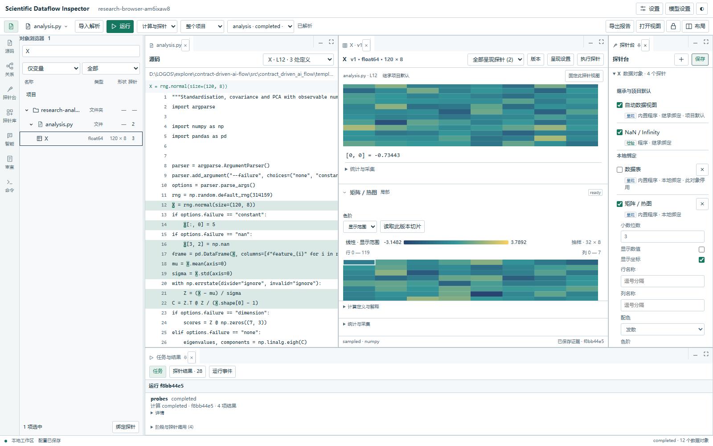
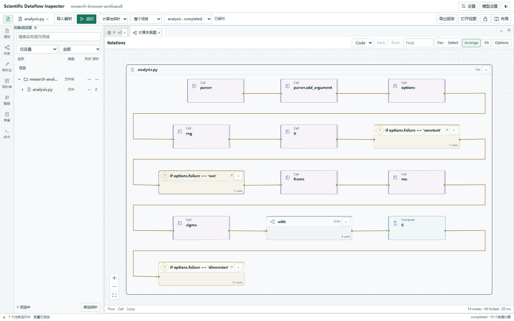
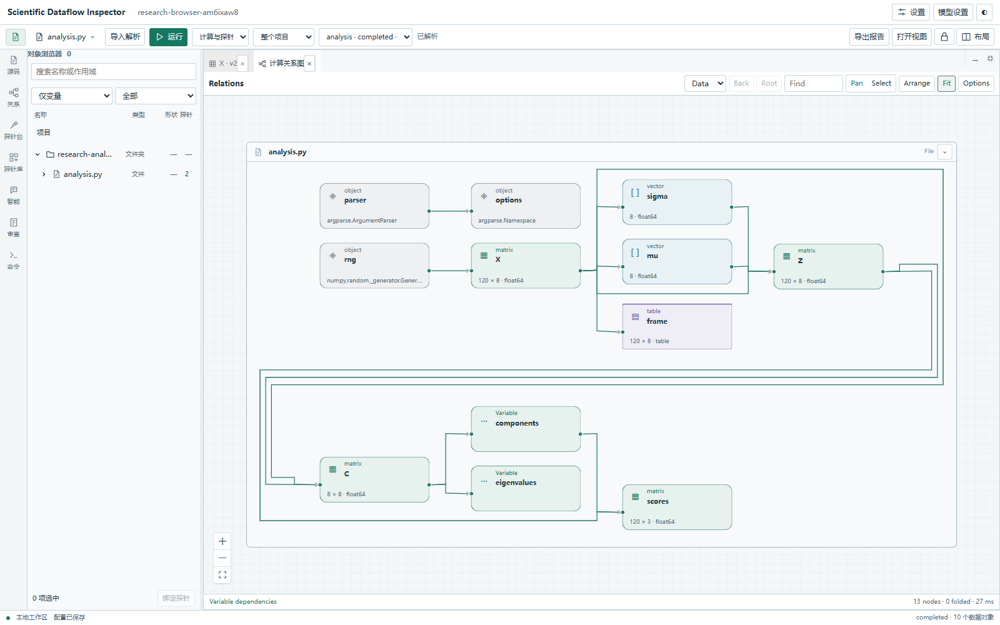

# 0.5.3：紧凑对象浏览与探针视图

本轮落实简洁、可操作的科研工作台：对象定义研究范围，绑定决定数据呈现，图只显示当前需要理解的关系。项目、历史源码、运行记录和既有模型配置保持原身份。

## 对象与数据

对象浏览器按目录、文件、函数和源码顺序排列。逻辑变量为叶子，同作用域重复定义合并，默认打开最近实际捕获的值；未执行分支不会替代真实值。历史通过数据页“版本”查看，并可对精确旧版本执行探针。选中仍关联全部同作用域源码引用，函数内同名遮蔽变量分别管理。

行后只保留类型、形状和启用探针数量。仅变量／全部与探针异常／正常／全部是两个独立筛选；无结果不会自动算作正常。移除赋值和观测子树及无含义的白色占位框。修复类型文本误用小图标样式和窄栏筛选宽度，默认对象栏加宽，用户已有布局保持可调整。

每个有效呈现绑定都有独立、可折叠的数据区域。默认显示全部，下拉可以单看一个；停用后视图和数量立即变化。检验、解释各自显示待执行状态或精确证据结果。数组数值表补齐真实抽样行列坐标，实际有索引的表格才显示索引列。收起区域会卸载昂贵呈现，隐藏文档停止绘制。第三方产物必须有实际执行结果，参数变化后旧产物显示待更新。

## Code 与 Data

关系图只保留两个模式。Code 显示简短计算标题与函数、条件、循环底板；移除变量、文档字符串和辅助入口出口。Data 只显示变量依赖，合并同作用域版本并收缩中间运算路径；归档语义图和原始关系引用保持完整。类型通过图标、形状和颜色区分。完整源码在 Source／Details 中查看。

画布使用英文标签，普通线不重复标字，分支条件保留在连接端口。移除未观测标签；运行证据通过 Options 显式开启。进入块后有 Back 和 Root。单击只选择，右键才打开数据、源码、详细信息或进入块；淡化无关节点默认关闭。

布局遵循统一单元宽度、同层对齐、端口合并、正交线路、层间独立线距及长顺序链分行。Arrange 在 Worker 中处理，保留固定节点；选择、数值更新和淡化不会重排。修复 ELK 0.11 对真实嵌套循环纵向图的额外压缩异常，保留实际输入回归夹具；移除会产生非法扫描线盒的可选后压缩步骤，保留常规分层优化。

30 行内置分析示例总览为 14 个 Code 节点或 13 个 Data 节点。这个数量仅针对该示例，复杂程序按结构折叠，不丢弃原关系。

## 状态与交互修复

保存与立即执行共享按顺序提交的配置版本，避免两个请求读取同一旧版本；外部修改仍显示明确冲突。异步任务只在结果槽位后台更新，不能抢走用户刚放大的图或数据页。可见文档与布局状态一致，面板控制不再因分组激活而丢失点击；放大、还原、缩小、锁定和不同窗口宽度保留回归检查。

历史证据与呈现参数分别核对。旧配置的结构／执行模式迁移为 Code，原保存文件保留；用户通过可选运行证据继续查看原记录。

## 参考与协作

参考 [MATLAB Workspace](https://www.mathworks.com/help/matlab/ref/workspacepanel.html) 的变量表，将值版本留在专用查看器。图布局采用现有 [React Flow 多端口 ELK 示例](https://reactflow.dev/examples/layout/elkjs-multiple-handles)、[ELK Layered](https://eclipse.dev/elk/reference/algorithms/org-eclipse-elk-layered.html)、[长链分行](https://eclipse.dev/elk/reference/options/org-eclipse-elk-layered-wrapping-strategy.html) 和[平衡节点对齐](https://eclipse.dev/elk/reference/options/org-eclipse-elk-layered-nodePlacement-bk-fixedAlignment.html)。这些资料用于交互和排线，不作为代码语义的来源。

按授权使用官方 DeepSeek Harness 和 `deepseek-official/deepseek-flash` 完成限定文件的局部实现。接受并独立检查对象树贡献；另外两次请求未在输出预算内交付可接受文件，未将它们算作完成。总监督期限结束后所属工作进程已退出，主代理完成集成、故障修复和最终验收。

## 验证

2026-10-04 完成本轮验收，详见[机器可读记录](../assets/workbench-compact-validation.json)与[发行说明](../release.md)。

| 路径 | 本轮结果 |
| --- | --- |
| 完整浏览器操作 | 87/87，无失败、跳过或重试后通过项 |
| 前端单元检查、类型与构建 | 103/103；类型及生产构建通过 |
| Python | 首轮 772 通过、8 个平台条件跳过；唯一失败是本地 editable 元数据仍登记 0.5.2，刷新安装后该项补测通过，共核对 773 项 |
| 原快捷方式及默认项目 | 桌面和内置核心均为 0.5.3；原 3 次运行、定义文件及原数据库记录保留，无渲染错误 |
| Windows 125% 缩放 | 真实矩阵、异常检查、绑定与重绘、共享 CLI 历史及关窗清理通过 |
| Windows 150% 缩放 | Python、CLI、Shell 三个真实终端通过中文输入、缩小恢复、重连及退出清理 |
| 启动与退出 | 缺失运行时、渲染进程异常、后端停止重试及可见退出动作通过 |
| 发行 | wheel 与源归档的隔离安装、CLI、实际绘图和服务生命周期通过；wheel、独立运行时、打包程序和实际安装中的 248 个核心文件逐字节一致 |

千级对象、万条历史事件夹具各采样 20 次，选中到下一帧 P95 为 6.1 ms，隐藏关系图时为 6.2 ms。测量同时检查选中样式实际变化，不包含冷导入、计算、绘图或模型推理。NSIS 已实际静默安装；交互式安装向导、签名及 macOS/Linux 原生桌面未完成。工作台模型任务验证使用离线模式和本地 HTTP 夹具，DSH 局部协作使用实际官方 Flash 接口。

文件夹导入、跨文件解析和重叠支流继续保留扩展协议与示例。本轮没有新增第三种图模式，也不自动修改实验代码。已有智能书写整理仍先提出保持语法树的候选，供用户审查。
