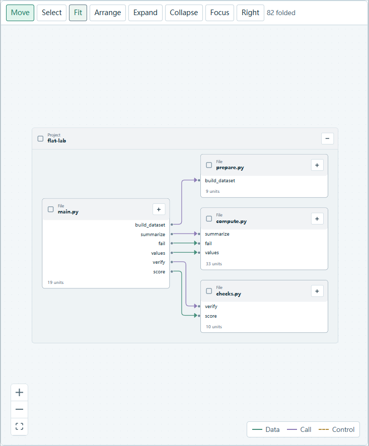

# 项目关系图呈现改进

本轮学习 [dbdiagram 的图与源码导航](https://docs.dbdiagram.io/basic-editing-experience/)、[详情等级](https://docs.dbdiagram.io/diagram-detail-levels/)、[分组](https://docs.dbdiagram.io/table-groups/)，并阅读 [drawDB 的关系路径实现](https://github.com/drawdb-io/drawdb/blob/914f8d2acac37d3ed3054abd2ab94e38efff9796/src/utils/calcPath.js) 和 [Easy RD 的关系交互](https://github.com/meursyphus/easy-rd/blob/4d324d684f4a3e9c71e84adfbbe2303c00bf17e7/src/lib/components/diagram/widget/Edge/Edge.ts)。在现有 React Flow／ELK 上独立实现紧凑连接行、渐进展开和关系强调，保留科研代码的控制与数据语义。

## 使用方式

- 每个块的标题显示种类和名称；折叠块补充内部单元数量。标题中的加减按钮只展开／折叠该块。长名称换行，完整内容保留在悬停提示中。
- 输入、输出名称对应各自的连接点。数据、调用、控制、返回关系分别有颜色和方向；控制关系保留条件标签，其余说明进入关系详情。
- 单击节点只选择，直接相关关系加粗。Focus 控制无关内容是否淡化，默认关闭。悬停或点击一条边只突出这条关系；点击打开详情，不改变范围或相机。
- 拖动节点标题调整位置，按 16 像素网格对齐。子块留在父板内部并避开标题。手工位置、折叠、方向和聚焦状态随视图保存。
- Expand 每次展开当前可见的下一层；Collapse 返回默认折叠总览。Arrange 清除手工位置后自动整理块和连线。Fit 显示全图；首次打开采用可读缩放，较大图可以平移探索。
- Right／Down 切换布局方向。纵向密集端口通过连接点提示和关系详情查看名称，避免标签互相遮盖。

## 实现位置

| 文件 | 职责 |
|---|---|
| `web/src/research/projects/graphPresentation.ts` | 语义投影、命名端口、节点尺寸、关系分类和折叠摘要 |
| `web/src/graph-semantic-layout.ts` | ELK 复合布局、标题留白和端口几何 |
| `web/src/research/projects/ProjectCanvas.tsx` | 选择、局部折叠、拖动边界、路由、关系详情与状态保存 |
| `web/src/research/projects/project-workspace.css` | 主题、标题／连接行、关系强调和紧凑图例 |

修复了展开后仅更新样式尺寸、未更新 React Flow 顶层宽高的问题。复合底板现在采用 ELK 实际尺寸，内部节点不再溢出底板。父块整体移动时同步平移其内部路径；独立端点移动时依据实时连接点绘制路径，Arrange 可重新计算完整布局。

## 验证

前端全部 154 项单元测试通过。项目浏览器原有 8 项回归和新增 4 项图形交互回归通过，覆盖真实跨文件运行、探针、终端、端口与方向、局部折叠、关系聚焦、导航／相机保持、父块边界和布局重开。

测试入口：`web/tests/project-diagram.spec.ts`、`web/tests/project-workbench.spec.ts`、`web/tests/project-workspace.test.ts`、`web/tests/research-graph-layout.test.ts`。安装入口专项验收为 `desktop/tests/project-diagram.cjs`，通过 `CDAF_DESKTOP_TEST_EXE` 指定实际安装 exe，所有测试项目和状态均使用临时目录。

Windows 实际安装 exe 已通过上述专项验收：1600／900 窗口宽度、明暗主题、局部展开和退出后的服务释放，未出现渲染异常。已安装程序的 130 个前端文件与构建产物一致；安装前后已有 10 个用户配置／记录文件摘要一致。旧程序包备份与安装回执位于 `.work/diagram-deploy-backup-20261024/`；本次测试回执位于 `.work/native-diagram-7sOYMS/receipt.json`。其他操作系统未做桌面运行验收。

本轮没有把静态关系升级为运行事实，也没有扩大模型读取授权。图仍受现有切片范围限制；显式 Fit 在大量内容展开时会缩小文字，局部展开或进入范围用于细读。
