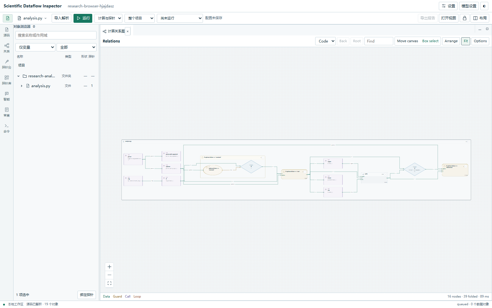
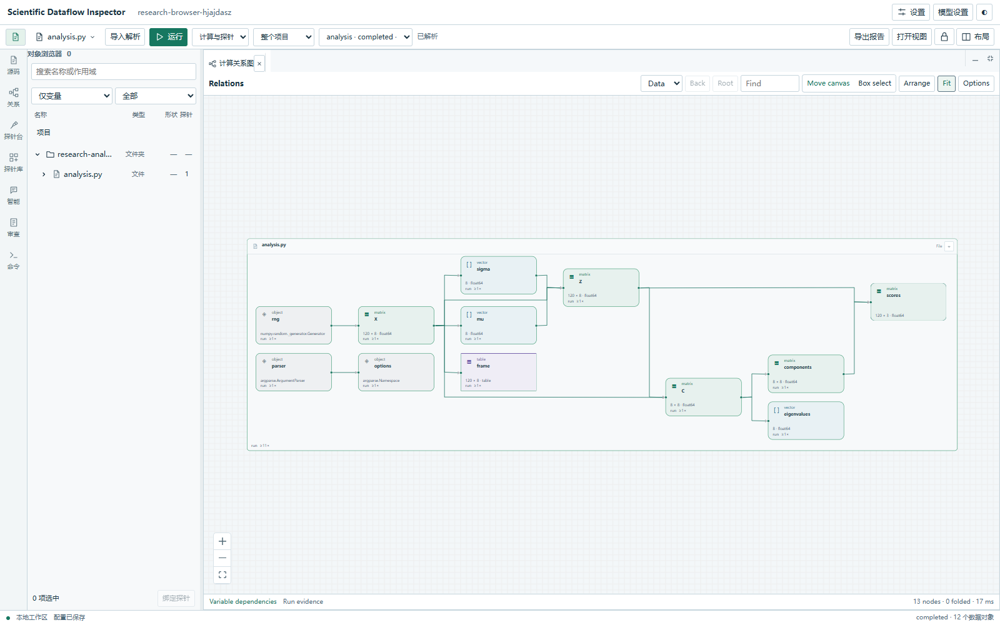
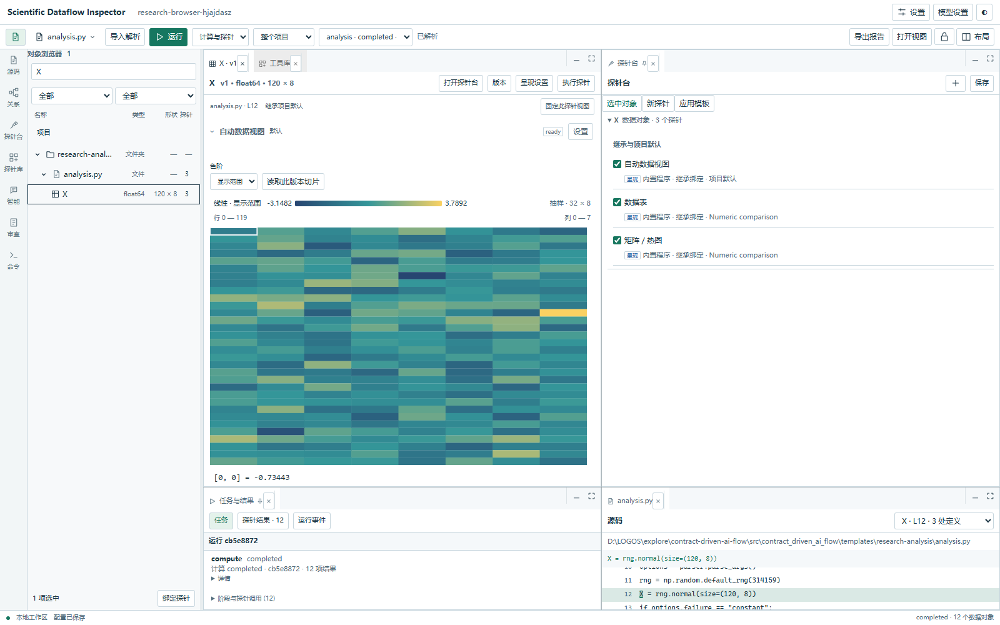

# 0.5.4：计算依赖、探针模板与通用模型服务

Code 图恢复计算单元和块之间的数据传递与条件关系。条件、循环使用圆形节点，运算使用菱形并显示短表达式；长条件换行。静态关系按源码推断，实际运行摘要单独开启，避免把程序纸面上的每个调用都连成顺序链。数据依赖与控制依赖的区别参考 [LLVM Dependence Graphs](https://llvm.org/docs/DependenceGraphs/index.html)；当前实现是 Python 语义图的显示投影，未实现完整的别名与副作用分析。

Arrange 使用 ELK Worker 的分层正交布局，保持依赖方向连续，不再强制将长链折回。节点宽高考虑换行，运行记录与类型信息分行显示。Move canvas 在空白处平移，Box select 在空白处框选；两种模式都允许移动节点，展开块通过标题栏拖动。选择只高亮，定位源码和进入块保留显式操作；块和计算单元的选择同步高亮对应源码范围。[React Flow viewport](https://reactflow.dev/learn/concepts/the-viewport) · [Sub flows](https://reactflow.dev/learn/layouting/sub-flows)。

探针台保留三个模式：“选中对象”查看和调整继承／本地绑定，“新探针”应用单个能力，“应用模板”应用一组配置。范围为当前选择或整个项目；文件、函数和控制块本身也能成为选择目标。“打开探针台”从数据页选择该变量，直接打开其绑定列表。结果详情留在数据页与任务结果管理中，不再在探针台堆叠所有历史结果。人工判断入口只在相应绑定打开时出现。

探针定义提供一种能力；参数预设保存一种能力的参数；探针模板包含多个成员，各自声明定义、参数、启用状态和预算。模板在“探针库 → 探针模板”创建、编辑和删除。应用模板会生成独立绑定，复制参数并记录模板名称和应用 ID。选中文件或函数时，成员应用到其中的兼容对象，执行计划冻结具体目标；没有兼容对象的成员会阻断模板应用。修改或删除模板不会改写已应用绑定；停用或删除绑定不会因刷新复活。联合输入算子仍单独绑定，要求显式指定输入角色。

“自动数据视图”现在是默认模板，包含自适应呈现成员，按对象类型提供基础图表。数据页只显示有效探针的结果，不再重复添加外部统计、计算解释或采集区，也移除“全部呈现探针／自动数据视图”选择器。成员可独立折叠、设置和固定。停用所有绑定后，只留下变量名和探针台入口。新项目不再暗中添加有限值检查；检验由用户显式绑定。旧的人工配置、停用例外、绑定 ID 和历史结果保持原记录。

模型设置新增空白通用服务，用户选择 OpenAI-compatible、Anthropic 或离线协议，再填服务地址和模型 ID。可选预设只填写协议和地址，不覆盖已有密钥引用、模型或服务身份。模型列表发现与连接测试不推理；实际推理需要明确操作。探针从已保存服务和模型选择，任务、重点、约束与输出格式保留独立字段。智能上下文策略和真实科研模型应用的扩展测试留到下一轮。

本次通用模型表单的五个文件由官方 DeepSeek Harness 中的 `deepseek-official/deepseek-flash` 在独立工作副本实现。固定文件范围、实际路由和退出记录保留在本地工作证据中；主代理检查补丁、修正协议地址并独立运行验收。该次开发协作不等同于工作台内远程科研推理验证。

完整验收结果、安装版本和包一致性见 [本轮验收记录](../assets/workbench-process-validation.json)。旧配置迁移仅识别旧版未修改的隐式有限值默认检查；有自定义参数、控制策略或对象例外的检查保留。源码、原运行 ID 和已保存证据不重新执行。
