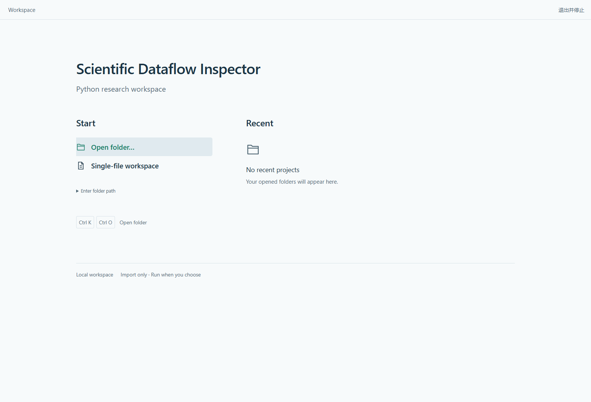

# 项目入口修复

原来的 Open folder 只是提交路径输入，空路径会禁用按钮；桌面没有接入文件夹选择器。旧测试先填写了路径，因此没有发现直接点击入口的问题。

现在参考 [VS Code 的打开项目流程](https://code.visualstudio.com/docs/python/python-quick-start)，采用 Start / Recent 两栏：主操作直接打开文件夹，最近项目按名称和路径呈现，手动路径收在次级入口。单文件兼容工作区独立保留，顶部控制合为一行。明暗主题及窄窗口沿用现有工作台的颜色和字体。

- 桌面点击 Open folder 调用 [Electron 系统目录对话框](https://www.electronjs.org/docs/latest/api/dialog#dialogshowopendialogwindow-options)，无需预先输入路径。取消不会创建项目或执行代码；失败显示错误并允许重试。
- 网页点击 Open folder 展开并聚焦路径输入；Enter folder path 也可直接展开，按 Enter 或 Open project 提交。
- 最近项目可直接重开。桌面支持 Ctrl+K、Ctrl+O；文本输入和终端保留自己的快捷键。
- 原生选择接口只向当前工作台主框架开放，不提供通用 IPC。重复请求共用一个选择窗口。

验证记录见[机器可读入口验收](../assets/project-entry-validation.json)。浏览器的模型化桌面能力、真实 Electron IPC、真实 Windows 系统窗口和安装后的快捷方式分开记录。真实窗口检查只取消由被测窗口拥有的对话框；后续指定目录结果的测试明确标记为模拟，实际导入、索引、计算及终端均使用真实服务。
