# Scientific Dataflow Inspector 系统与代码架构

进程部署 模块依赖 核心类 调用链和数据存储

**源码基准**　0.6.0 开发候选版 · `1caa4ead427625815ee473bc3b9c965b795e0479`

**核对日期**　2026 年 10 月 17 日

本文以当前源码为准，图示对应真实进程、模块、类和方法，分别标明进程通信、对象持有与代码依赖。

## 01 系统由哪些进程组成

系统主体是 **Python 模块化单体服务，加独立执行进程和 React 客户端**。Electron 负责桌面宿主，FastAPI 承载本机接口，业务规则集中在 Python 应用服务。浏览器、桌面和命令行是入口，图形布局与科研计算运行在不同执行环境中。

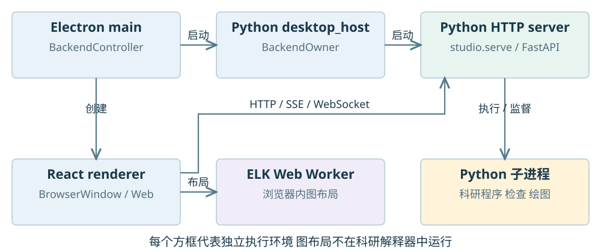

桌面主进程的 `main.cjs` 创建 `BackendController`，后者使用 `BackendHost`。`backend.cjs` 启动 Python 模块 `application.desktop_host`，通过标准输入输出交换启动状态和停止命令。这个辅助进程持有 `BackendOwner`，再由 `studio.start()` 启动真正的 HTTP 服务进程。**所有权辅助进程与 HTTP 服务进程是两个进程。**

`studio.serve()` 根据管理目录选择应用工厂：科研模式使用 `create_research_app()`，旧契约目录使用 `api.create_app()`，旧多项目工作空间使用 `create_workspace_app()`。这些分支共用科研路由能力，但初始化入口和宿主不同。桌面打包携带独立 Python；科研入口还可选择自己的解释器。

CLI 批处理直接创建并调用应用服务；Textual 交互客户端既可以调用本地服务对象，也可以连接已有回环 HTTP 服务。普通 Web 客户端没有 Electron 辅助进程。ELK 使用浏览器 Worker，科研分析、检查和绘图使用操作系统子进程，不能将两类 Worker 混为一谈。

源码：[C01](#code-c01)、[C02](#code-c02)、[C03](#code-c03)、[C13](#code-c13)。

## 02 源码目录和实际依赖

以下目录相对仓库根目录。Python 包名仍是 `contract_driven_ai_flow`，当前科研工作台主要位于它的 `research/` 下；根包保留了早期契约编排代码。

```text
src/contract_driven_ai_flow/
  cli.py  studio.py  api.py       命令入口 服务启动 通用鉴权
  application/                   命令分发 所有权与生命周期
  research/
    service.py  store.py          科研进程监督与实验记录
    models.py  runners.py        证据模型与运行器协议
    projects/                    多文件项目 索引 查询 运行 智能 修改
    workbench/                   配置 探针 任务 绘图 推导 终端
      intelligence/              共用模型工具循环
    agent/                       科研解释器中的插桩 采集与传输
  settings/                      模型配置 凭据和调用记录
  terminal/                      Textual 交互客户端
  compiler.py  execute.py ...     旧契约编排实现
web/src/research/                 React 项目和单文件客户端
desktop/src/                     Electron 宿主及受限 IPC
```

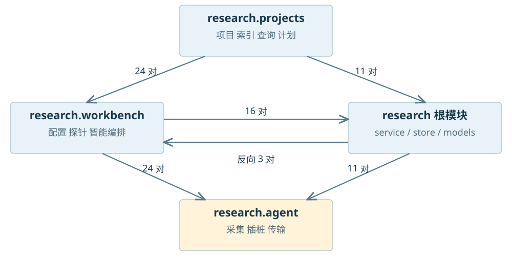

图 2 的实线表示源码中存在的 Python 导入方向，不表示跨进程通信。对当前 `src/contract_driven_ai_flow/` 的静态扫描得到 143 个 Python 文件、31,142 个物理行和 481 对模块导入关系；统计包含空行、注释和函数内导入，不含前端、测试或动态构造的导入。图中只保留主要关系。

当前代码**存在双向包依赖**：项目层复用工作台和科研服务，科研路由又装配项目层；部分导入放在函数或属性内部。它是已有兼容路径上扩展出的模块化单体，没有严格满足“所有依赖只能单向向下”的分层模型。把它画成完全独立的微服务或无环整洁架构，会与实际代码不符。

源码：[C04](#code-c04)、[C05](#code-c05)、[C06](#code-c06)、[C07](#code-c07)。

## 03 应用服务如何装配核心对象

项目科研服务由 `research.routes.create_research_app()` 作为装配入口创建。`ProjectApplication` 管理主机级项目登记、共享预算和项目专属服务缓存，HTTP 请求通过路径中的项目 ID 解析服务，后台没有可由另一个窗口覆盖的全局活动项目变量。

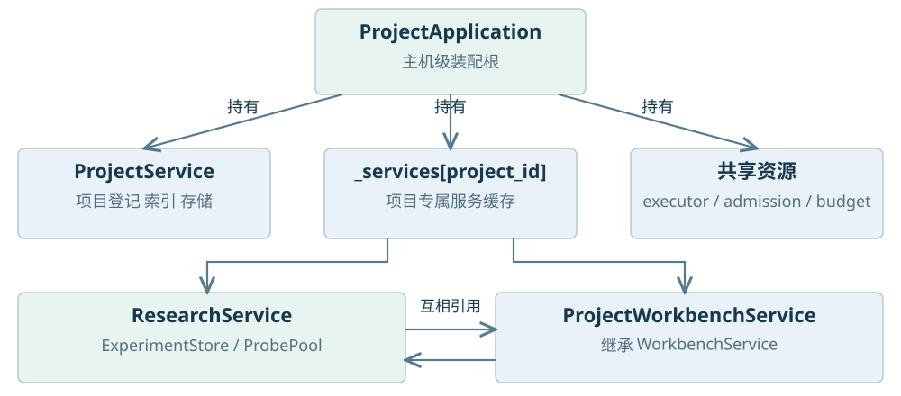

`ProjectApplication._service(project_id)` 为项目创建一对服务：`ResearchService` 管运行进程与实验记录，`ProjectWorkbenchService` 管冻结计划及探针后处理。它们互相持有同一对象引用：`research._workbench = workbench`，`workbench.research = research`。这两个引用用于同项目内协作，不是进程通信。

`ProjectWorkbenchService` **继承** `WorkbenchService`。基类已经组合 `ConfigurationStore`、`WorkbenchStore`、`ProbeCatalog`、`ResourceManager`、`ToolManager`、`DrawingService`、`SemanticsService`、`PreferenceService` 和 `JobManager`；项目子类扩展入口、版本、清单与跨文件执行。绘图服务复用 `ResearchService.pool`，不会再创建一套独立检查池。

`ResearchService` 持有 `ExperimentStore`、`RunnerRegistry`、`ProbeRegistry`、`ProbePool` 与 `_active` 运行表。应用层把同一个计算预算、后台线程池和准入信号量注入各项目服务；资源是否由当前对象拥有，决定它在 `close()` 时能否关闭该资源。

源码：[C04](#code-c04)、[C05](#code-c05)、[C06](#code-c06)、[C07](#code-c07)、[C33](#code-c33)。

## 04 静态分析和项目索引的调用链

静态分析链负责读取文件和产生结构记录，不执行用户程序。它与后面的运行采集链有独立的数据入口和失败状态。

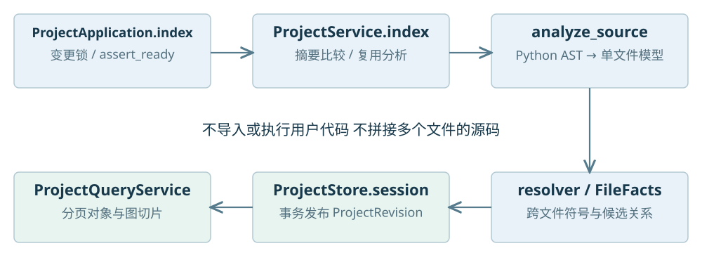

主要调用是 `ProjectApplication.index()` → `ProjectService.index()`。前者取得与修改应用共用的项目变更锁并检查恢复状态；后者调用 discovery 发现文件，以摘要判断是否复用旧分析，再调用 `workbench.analysis.analyze_source()` 和项目 resolver。索引写入 `ProjectStore.session()`，成功后发布新项目版本；异常或取消回滚未提交内容。

`analyze_source()` 使用 Python `ast.parse()`，构建 `AnalysisDocument`。平面对象和关系保留旧接口，`semantics.py` 进一步建立 `SemanticGraph`，包含结构块、计算节点、控制与数据边。`projects.resolver` 汇总每文件 facts 与模块名，解析导入、符号、直接调用、参数和返回候选。这里没有将文件拼接成一段源码。

查询经 `ProjectQueryService` 读取已发布索引，提供树、对象、符号、引用和图切片。分页尽量使用 SQLite JSON 查询和紧凑记录，避免实例化全项目的完整分析。大项目图先用紧凑索引构造总览，再按范围取细节；单文件语法错误仍作为该文件的诊断保留。

文件监听由 `ProjectIndexService` 和元数据轮询线程实现，按需启用后合并变化、取消与进度。它不等于每次点击图节点都重建索引。增量复用的是未变文件分析，项目关系发布仍有版本级工作。

源码：[C08](#code-c08)、[C09](#code-c09)、[C10](#code-c10)、[C11](#code-c11)、[C12](#code-c12)。

## 05 核心模型如何连接源码与执行

系统使用 Pydantic wire model 约束跨层数据。模型分布在 `research/models.py`、`workbench/models.py`、`workbench/semantic_models.py` 与 `projects/*_models.py`。不同模型族各有协议版本，不能把“项目协议版本”和“整个应用版本”当成同一个数。

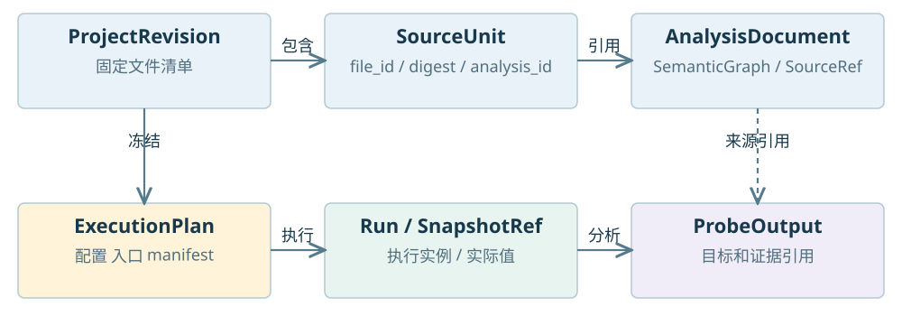

| 模型族 | 主要类型 | 保存的事实 |
| --- | --- | --- |
| 项目与源码 | ResearchProject、SourceUnit、ProjectRevision | 项目身份、相对路径、摘要和版本清单 |
| 静态结构 | AnalysisDocument、SemanticGraph、SourceRef | 对象、作用域、计算结构与源码范围 |
| 目标与意图 | TargetRef、ScopeSelector、RunConfiguration | 逻辑目标、选择范围和入口意图 |
| 冻结执行 | ExecutionPlan、ResolvedProbeCall | 当时配置、定义、输入和清单引用 |
| 真实证据 | ObservationEvent、SnapshotRef、OperationRecord | 事件序号、值版本和运算输入输出 |
| 结果与修改 | ProbeOutput、DerivedData、ProjectChangeSet | 分析结果、父输入和待审查文件变更 |

项目 UUID 存在 `workbench.yaml`；文件 ID 从项目 ID 与相对路径派生。逻辑键还区分词法作用域，运行期作用域区分函数调用实例；快照 ID 指向某次实际采集值。文件重命名不天然保持同一个文件 ID，多次赋值也不能仅靠变量名合并。

`SourceRef` 把文件、摘要、行列、作用域、项目版本带到事件与结果。`TargetRef` 既可表示跨运行的逻辑目标，也可携带精确运行和快照引用。静态图边的 `provenance` 与快照 `fidelity` 分别说明关系来源和数据精度；两者表达不同维度。

源码：[C17](#code-c17)、[C18](#code-c18)、[C30](#code-c30)、[C31](#code-c31)。

## 06 一次计算经过哪些方法和进程

科研程序由选定解释器运行，服务端负责冻结与监督，agent 在科研解释器中执行插桩和观察。下面只画真实计算 `compute` 路径；`probes` 和 `replot` 读取历史证据，跳过入口执行。

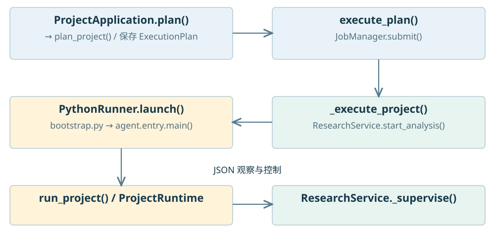

`ProjectApplication` 校验项目版本与入口，创建源码 manifest。`ProjectWorkbenchService.plan_project()` 冻结工作台配置、定义、范围、清单引用，以及私有运行环境快照。项目模式保留紧凑选择器，不在启动前为项目内全部对象生成巨大调用列表；获得精确采集值后再解析有效探针调用。

`execute_plan()` 把任务提交到 `JobManager`；`_execute_project()` 复核清单与私有解释器环境，调用 `ResearchService.start_analysis()`。后者创建运行记录、回环监听 socket、私有 job 文件、`ActiveRun` 和进程树，再通过 `PythonRunner.launch()` 启动 `agent/bootstrap.py`。科研 stdout/stderr 与结构化事件使用不同通道。

agent 的 `entry.main()` 创建 `AgentChannel`、`EventTransport`、`AdapterRegistry` 和 `TraceSession`，项目任务转入 `run_project()`。`ProjectRuntime` 仅包装标准 `SourceFileLoader`，对冻结清单内实际加载的项目源码插桩，保留包属性、相对导入与缓存行为。模块全局和各函数调用使用独立作用域，一次项目运行共用证据会话与控制收集器。

父进程 `_supervise()` 收集事件、处理检查与控制、监测退出和超时，最后收束状态并释放预算。依赖文件变化时，摘要校验阻止将混合源码记作同一完整版本。第三方包、自定义加载器与子进程内部不会被无界自动追踪。

源码：[C05](#code-c05)、[C07](#code-c07)、[C13](#code-c13)、[C14](#code-c14)、[C39](#code-c39)、[C40](#code-c40)。

## 07 采集与传输为何分成两层

`TraceSession` 是科研解释器内的观察会话。插桩生成的 `ObservationRuntime` 在赋值、运算、函数和控制边界调用会话；适配器把活对象转成描述符、样例、统计和可选完整产物。数据编码完成后才进入队列，后续活对象变化不会改写已发布历史。

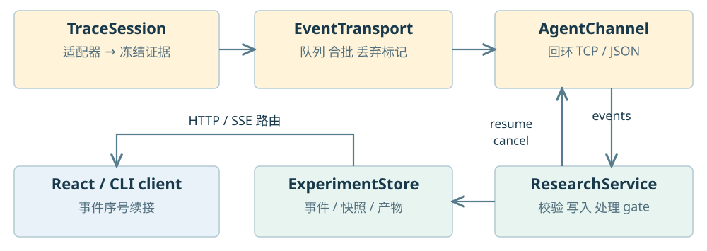

`EventTransport` 提供有界普通队列、关键事件预留、合批发布和丢弃计数。`AgentChannel` 负责带 token 握手的回环 TCP 连接，采用换行分隔的严格 JSON 消息；这是私有 agent 协议。`events` 向父进程批量发布观察，反向 `continue / resume / cancel` 处理控制。需要阻断检查的边界等待父端答复，失联不能按通过继续。

**有三个不同大小边界。** 传输队列的单事件上限是 512 KiB，agent 发送帧上限是 1 MiB，公共 `ObservationEvent` 模型还限制自身序列化大小为 2 MiB。它们处于不同层次，某条路径实际受更小限制约束。事件队列默认 2048 条或 8 MiB，普通发布间隔默认 100 ms，控制明细上限 512 条。

父服务将验证和脱敏后的记录写入 `ExperimentStore`。浏览器再通过可续接 SSE 读取存储事件，使用事件序号推进；agent 不直接向浏览器发消息。完整数值数据另存 NPY、表格可存 Arrow，JSON 只携带有界内容和产物引用；未知或截断保持显式状态。

源码：[C14](#code-c14)、[C15](#code-c15)、[C16](#code-c16)、[C31](#code-c31)、[C36](#code-c36)。

## 08 探针子系统的内部结构

探针子系统由能力注册、作者配置、范围解析、冻结调用、执行分发、结果存储和前端呈现共同组成。当前仍有集中分发方法，输入输出协议已经分开。

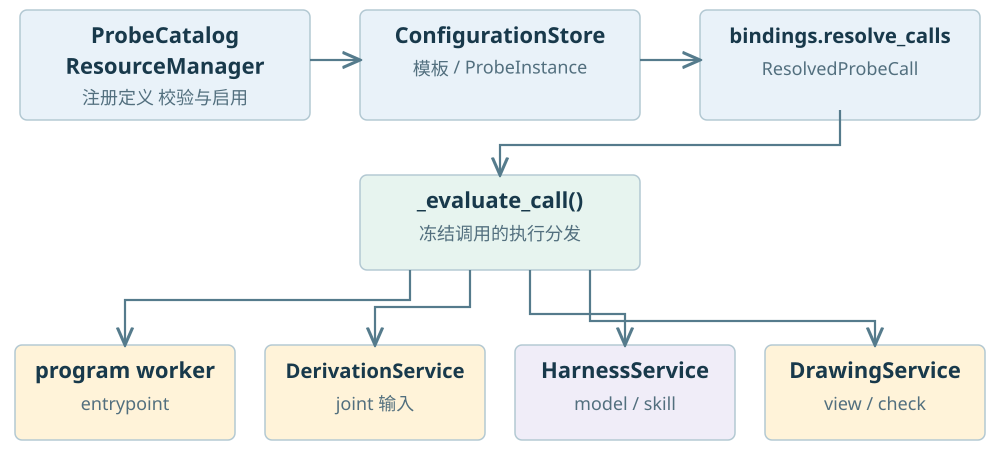

`ProbeCatalog` 保存 `ProbeDefinition`；`ResourceManager` 导入、校验并启用扩展定义；`ConfigurationStore` 在 YAML 保存模板和 `ProbeInstance`。`bindings.py` 处理选择器、有效默认与局部覆盖，生成 `ResolvedProbeCall`。模板应用复制成员参数，后续编辑模板不修改旧实例。

`WorkbenchService._postprocess()` 在配置上限内并行执行调用，并持久化 invocation 与 output。`_evaluate_call()` 按实际分发顺序处理：声明自定义 `entrypoint` 时交给独立程序 worker；`joint` 输入进入联合处理；模型和 Skill 使用 harness；结构、关系或时间等按其处理器计算；数据呈现和普通检查进入 `DrawingService`。联合路径再区分比较与派生计算，派生交给 `DerivationService`。

运行期阻断检查是另一条路径：项目执行将检查配置传给 `ResearchService`，父端 `ProbePool` 产生结果，独立控制策略决定继续、暂停或取消。它不能与计算结束后的重绘、模型解释混成同一种同步 gate。历史结果读取不会再次触发运行控制。

自动数据视图由 `auto-data` 模板中的 `view.auto` 成员提供。前端通过有效 presenter 配置呈现，绑定停用后不应存在额外自动绘制旁路。推导创建 `DerivedData` 与新快照，保存全部父输入引用，不修改原快照。

源码：[C06](#code-c06)、[C17](#code-c17)、[C18](#code-c18)、[C19](#code-c19)、[C20](#code-c20)、[C37](#code-c37)。

## 09 前端组件和关系图渲染链

前端按项目宿主、工作区协调、领域文档和基础组件分工。它没有将科研解释器搬进浏览器；计算请求最终仍进入 Python 服务。

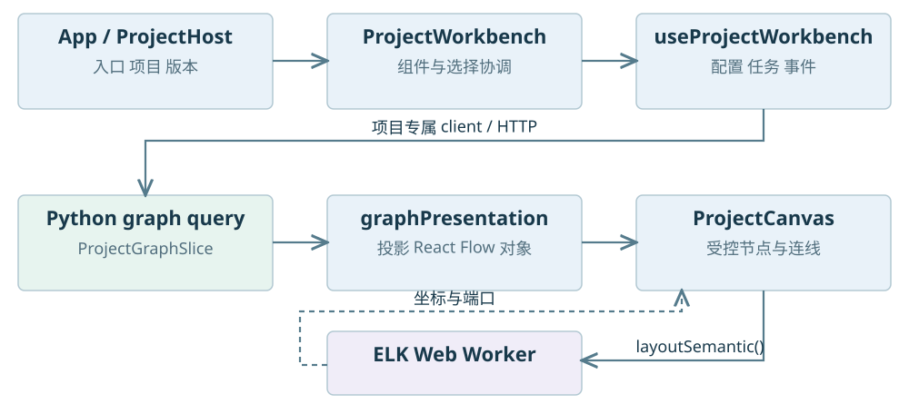

`App` 选择项目工作台、单文件兼容入口或旧架构工作区。`ProjectHost` 管项目登记、重开、索引及版本；`ProjectWorkbench` 组合共享的 Dockview、探针、源码、任务和设置组件。`ResearchServicesProvider` 注入不可变的项目专属客户端；`projectCommands.ts` 和 `queries.ts` 显式携带项目 ID。

`useProjectWorkbench()` 协调配置保存队列、当前运行、SSE 事件、探针输出和后台任务。配置编辑有 dirty 标记和串行保存队列；订阅有取消与运行身份检查，迟到消息不能覆盖新运行。选择目标、浏览范围、文档标签和相机分别保存，没有塞入一个可变图对象。

关系图链路是后端 `ProjectQueryService.graph()` → `ProjectGraphSlice` → `graphPresentation.presentProjectGraph()` → `ProjectCanvas`。其中共享 `graph-projection` 负责折叠与边界关系，`graph-semantic-layout` 构造 ELK 输入，`graph.layoutSemantic()` 在专用 Worker 执行，再返回真实节点和端口坐标给 React Flow。

Code 与 Data 是同一 `SemanticGraph` 的两类投影；运行证据是其叠加信息。布局依赖图与折叠身份，选择覆盖层不进入布局依赖。后端协议由 Python 模型导出 Schema，再生成 TypeScript；前端仍有视图专属类型，不宣称所有 React 状态都由后端生成。

源码：[C21](#code-c21)、[C22](#code-c22)、[C23](#code-c23)、[C24](#code-c24)。

## 10 智能层由哪些类组成

智能层复用模型设置、工具循环和任务管理，同时为项目模式注入独立上下文和工具集合。模型调用服务与项目数据读取授权有不同职责。

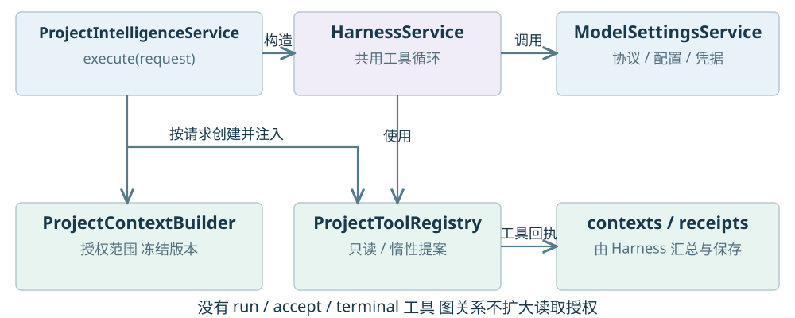

`ProjectIntelligenceService.execute()` 为每次请求创建 `ProjectContextBuilder` 和 `ProjectToolRegistry`，再将它们注入共用的 `HarnessService`。模型配置来自 `ModelSettingsService`，支持离线、OpenAI 兼容及 Anthropic 协议；凭据由系统凭据库或显式环境引用解析，项目只引用配置。

上下文绑定项目、版本、范围和允许读取的文件。工具只从冻结索引与授权证据取内容，支持目录描述、符号搜索、引用查询、源码片段和探针目录。Harness 控制步骤、调用与消息预算，保存模型调用、工具回执和引用；token 预算采用保守估算，不保证与每家服务的精确 tokenizer 一致。

代码角色增加 `changes.propose`，形成惰性的 `ProjectChangeSet`。项目工具没有直接运行、接受修改或终端执行功能；图上的数据、调用或包含边不自动扩大授权。终端输出也不会自动进入模型上下文。任务执行期间版本发生变化，构建器和工具返回冲突。

离线与受控传输测试可以验证接口和隔离规则，真实外部模型的解释、建议和代码质量仍需独立验收。本文没有发起新的模型调用。

源码：[C25](#code-c25)、[C26](#code-c26)、[C27](#code-c27)、[C28](#code-c28)、[C38](#code-c38)。

## 11 跨文件修改的事务与恢复

跨文件编辑由 `ProjectChangeService` 管理，独立于模型。HTTP 接口和模型工具创建的提案都需要遵守同一摘要校验和恢复规则。`ProjectChangeSet` 保存基础项目版本、逐文件操作与摘要、验证记录、影响引用及状态。

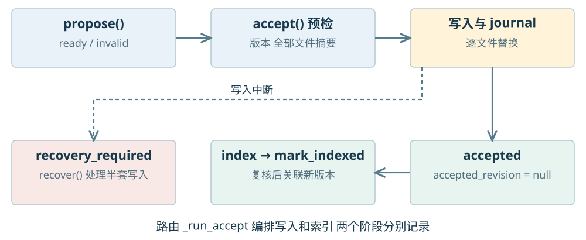

`propose()` 只建立待审查数据；`accept()` 先取得项目级跨进程锁，再检查基础版本和全部文件的修改前摘要。通过后用已保存候选、备份和 journal 逐文件替换，先记为 `accepted`，此时 `accepted_revision` 仍为空。路由中的编排函数再调用应用索引，并用 `mark_indexed()` 复核候选摘要后关联新版本。索引使用相同变更锁，避免观察到半套修改；“文件已写入”和“新索引已关联”仍是两个状态。

这是**可恢复的多文件变更协议**。单文件替换可用原子替换，多文件整体不具备一次性文件系统原子提交。写入中断留下 `recovery_required`；`assert_ready()` 阻止计算、索引和智能请求继续使用不完整状态。`recover()` 对照已写文件和日志完成恢复，`rollback()` 产生新的反向提案，不覆盖后来的编辑。

操作支持新建、修改与受约束格式调整。格式调整检查 AST、注释和语句顺序；语法与导入验证不等于运行科研测试。验证记录分别表达 pass、fail、not_run、not_validated，提案接受也不会自动执行实验。

源码：[C29](#code-c29)、[C30](#code-c30)、[C04](#code-c04)。

## 12 存储架构和数据关系

存储按职责拆成作者定义、项目索引、实验记录、工作台记录和主机设置。它们在一个本地应用里协作，没有统一跨库数据库事务，也没有把所有数据放进一个巨大 JSON 字段。

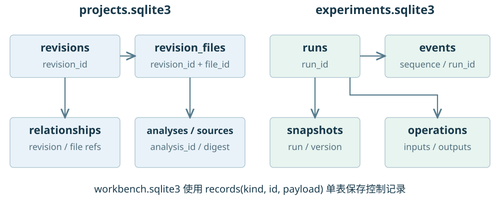

`ProjectStore` 的 `projects.sqlite3` 用 `revisions` 和 `revision_files` 保存历史文件清单，`analyses` 保存每文件分析与 facts，`sources` 按摘要归档，`relationships` 关联一个版本内的文件关系。`files` 只是当前文件索引，回看历史必须走版本清单。

`ExperimentStore` 的 `experiments.sqlite3` 保存 runs、events、snapshots、operations、control_summaries、control_details、control_receipts 和产物保留引用。事件序号在数据库中自增，并通过运行 ID 过滤；不能假定每次运行的序号都从 1 连续开始。快照与运算包含运行引用和 JSON body，数值大产物另存文件。

`WorkbenchStore` 的 `workbench.sqlite3` 使用一张 `records(kind,id,payload,created)` 表，分别保存 plans、tasks、outputs、contexts、resources、invocations、derived 等小型记录，单条限制 4 MiB。它不是为每个 Python 类都建一张表。图 12 的连线表示逻辑键关系，不表示全部由 SQL 外键强制维护。

`workbench.yaml` 保存入口、绑定和模板，由配置版本校验加原子替换保存。主机注册表、运行环境引用、模型设置和系统凭据分开；`.cdaf/studio.json` 含会话令牌，不能共享。SQLite 连接按事务关闭，项目索引提供线程局部 session；跨数据库和文件的一致性依靠清单、摘要、任务状态及恢复日志配合。

源码：[C12](#code-c12)、[C31](#code-c31)、[C32](#code-c32)、[C37](#code-c37)、[C38](#code-c38)。

## 13 并发 安全边界与关闭顺序

并发分为后台任务、科研进程、探针后处理、独立检查池和浏览器布局。每种限额控制不同资源，不能简单相加为一个“最大并发数”。

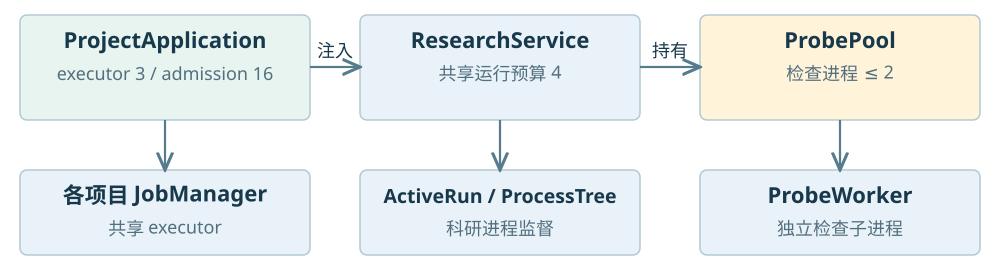

| 资源 | 当前默认 | 所有权与用途 |
| --- | --- | --- |
| 应用后台 executor | 3 线程 | ProjectApplication 共享给各 JobManager |
| 任务准入 semaphore | 16 槽 | 提交持久任务前申请，满时明确拒绝 |
| 科研运行预算 | 4 槽 | 各项目与兼容入口共享 |
| 探针后处理 | 配置默认 4，限制 1…16 | 每个后处理任务中的线程池；模型调用另加锁 |
| ProbePool | 最多 2 子进程，默认 16 待处理 | ResearchService 持有，DrawingService 复用 |
| 终端 | 真实 PTY 会话 | TerminalService 管理进程与有界输出 |

任务提交复制请求上下文；取消信号传给工作进程和任务函数。任务、计算、质量结果和采集完整性保留不同状态。服务重启将失去所有者的运行或任务标记中断，不能把它们当作正常完成。已经持久提交的修改不应被迟到取消重写成未提交。

本地 HTTP 经过 `secure_app()` 校验会话、Host 和 Origin；Electron preload 只暴露有限 IPC，renderer 不启用 Node 集成。agent 使用私有握手连接，终端通过受控 WebSocket。**这些控制并不构成用户代码或插件的操作系统沙箱。**

关闭时先由所有者停止自己管理的任务与子进程，再结束后端与辅助进程；浏览器租约提供刷新宽限，借用已运行服务的窗口不会获得该服务的所有权。当前 `backend.cjs` 仍丢弃辅助 Python 的 stderr，部分清理路径捕获异常后不记录，这构成诊断盲点；本文记录现状，没有顺带修改启动实现。

源码：[C01](#code-c01)、[C03](#code-c03)、[C05](#code-c05)、[C33](#code-c33)、[C34](#code-c34)、[C35](#code-c35)。

## 14 扩展边界和代码阅读顺序

扩展接口分别位于采集、检查、运行、呈现和智能层。新增类型或第三方包应先明确落在哪条边界，避免直接修改主工作台组件。

| 扩展 | 实际协议或入口 | 必须保留的条件 |
| --- | --- | --- |
| 新数据类型 | DataAdapter 的 supports、describe、capture | 有界捕获，描述精度，不隐式物化 |
| 新科学检查 | ProbeRegistry、evaluate(context) | 冻结证据，独立进程，结构化结果 |
| 新运行环境 | RunnerAdapter.launch(job, job_file) | 父进程保留监督和证据所有权 |
| 自定义程序与绘图 | ProbeResource、ProbeDefinition.entrypoint | 清单审查、参数 Schema、版本与预算 |
| 新前端呈现 | renderer-registry 的 supports 与组件 | 受有效探针控制，重新构建前端 |
| 新模型协议 | ProviderProfile 和 ModelSettingsService | 凭据引用、超时、工具与用量回执 |

Python 插件入口组包括 `cdaf.research.adapters`、`cdaf.research.probes` 与 `cdaf.research.runners`，均要求显式启用。接口可扩展不等于目前已经具备 Notebook、多语言、GPU、稀疏和分布式执行支持。前端也不从网络加载任意 JavaScript 插件。

建议阅读顺序为：**装配 → 模型 → 计划与执行 → 证据 → 探针 → 前端 → 智能和修改**。先读 `ProjectApplication._service()`，再读 `ProjectWorkbenchService.plan_project()`、`_execute_project()` 和 `ResearchService.start_analysis()`，能最快建立整套调用关系。

当前的主要维护成本在集中编排与兼容耦合：`projects/queries.py` 1185 行、`projects/resolver.py` 1041 行、`workbench/service.py` 993 行、`projects/workbench.py` 970 行。这里统计物理行，包含空行与注释；行数只帮助定位大文件。后续拆分应围绕查询投影、计划编译、调用执行和服务装配，保留现有版本与证据边界，而不把仅有目录分组误认为已经解耦。

本文的调用关系来自源码读取与静态导入核对；没有执行科研入口、模型调用、安装升级或全量软件回归。下方索引固定到核对提交，图示可与对应类和方法逐项对照。

源码：[C04](#code-c04)、[C06](#code-c06)、[C07](#code-c07)、[C13](#code-c13)、[C36](#code-c36)。

## 15 固定版本源码索引

以下 Python 路径相对 `src/contract_driven_ai_flow/`；`web/` 与 `desktop/` 路径相对仓库根目录。链接固定到核对提交，行号在生成时从实际定义定位。

<!-- CODE_INDEX -->

| 编号 | 源码位置 | 对应职责 |
| --- | --- | --- |
| <a id="code-c01"></a>C01 | [studio.py:205](https://github.com/iyohesohoka646-dotcom/SFA/blob/1caa4ead427625815ee473bc3b9c965b795e0479/src/contract_driven_ai_flow/studio.py#L205) | 服务进程启动与应用工厂 |
| <a id="code-c02"></a>C02 | [desktop/src/main.cjs:1](https://github.com/iyohesohoka646-dotcom/SFA/blob/1caa4ead427625815ee473bc3b9c965b795e0479/desktop/src/main.cjs#L1) | Electron 宿主 |
| <a id="code-c03"></a>C03 | [desktop/src/backend.cjs:3](https://github.com/iyohesohoka646-dotcom/SFA/blob/1caa4ead427625815ee473bc3b9c965b795e0479/desktop/src/backend.cjs#L3) | 所有权辅助进程启动 |
| <a id="code-c04"></a>C04 | [research/projects/application.py:26](https://github.com/iyohesohoka646-dotcom/SFA/blob/1caa4ead427625815ee473bc3b9c965b795e0479/src/contract_driven_ai_flow/research/projects/application.py#L26) | 应用装配与共享预算 |
| <a id="code-c05"></a>C05 | [research/service.py:98](https://github.com/iyohesohoka646-dotcom/SFA/blob/1caa4ead427625815ee473bc3b9c965b795e0479/src/contract_driven_ai_flow/research/service.py#L98) | 科研进程监督与控制 |
| <a id="code-c06"></a>C06 | [research/workbench/service.py:26](https://github.com/iyohesohoka646-dotcom/SFA/blob/1caa4ead427625815ee473bc3b9c965b795e0479/src/contract_driven_ai_flow/research/workbench/service.py#L26) | 探针和工作台组合服务 |
| <a id="code-c07"></a>C07 | [research/projects/workbench.py:52](https://github.com/iyohesohoka646-dotcom/SFA/blob/1caa4ead427625815ee473bc3b9c965b795e0479/src/contract_driven_ai_flow/research/projects/workbench.py#L52) | 项目冻结计划与执行 |
| <a id="code-c08"></a>C08 | [research/projects/service.py:56](https://github.com/iyohesohoka646-dotcom/SFA/blob/1caa4ead427625815ee473bc3b9c965b795e0479/src/contract_driven_ai_flow/research/projects/service.py#L56) | 项目索引与版本发布 |
| <a id="code-c09"></a>C09 | [research/workbench/analysis.py:32](https://github.com/iyohesohoka646-dotcom/SFA/blob/1caa4ead427625815ee473bc3b9c965b795e0479/src/contract_driven_ai_flow/research/workbench/analysis.py#L32) | 单文件 AST 分析 |
| <a id="code-c10"></a>C10 | [research/projects/resolver.py:325](https://github.com/iyohesohoka646-dotcom/SFA/blob/1caa4ead427625815ee473bc3b9c965b795e0479/src/contract_driven_ai_flow/research/projects/resolver.py#L325) | 跨文件候选关系 |
| <a id="code-c11"></a>C11 | [research/projects/queries.py:100](https://github.com/iyohesohoka646-dotcom/SFA/blob/1caa4ead427625815ee473bc3b9c965b795e0479/src/contract_driven_ai_flow/research/projects/queries.py#L100) | 分页和图投影查询 |
| <a id="code-c12"></a>C12 | [research/projects/store.py:12](https://github.com/iyohesohoka646-dotcom/SFA/blob/1caa4ead427625815ee473bc3b9c965b795e0479/src/contract_driven_ai_flow/research/projects/store.py#L12) | 规范化索引表与事务 |
| <a id="code-c13"></a>C13 | [research/runners.py:10](https://github.com/iyohesohoka646-dotcom/SFA/blob/1caa4ead427625815ee473bc3b9c965b795e0479/src/contract_driven_ai_flow/research/runners.py#L10) | 运行器协议与 Python 启动 |
| <a id="code-c14"></a>C14 | [research/agent/sdk.py:26](https://github.com/iyohesohoka646-dotcom/SFA/blob/1caa4ead427625815ee473bc3b9c965b795e0479/src/contract_driven_ai_flow/research/agent/sdk.py#L26) | 科研解释器中的观察会话 |
| <a id="code-c15"></a>C15 | [research/agent/transport.py:11](https://github.com/iyohesohoka646-dotcom/SFA/blob/1caa4ead427625815ee473bc3b9c965b795e0479/src/contract_driven_ai_flow/research/agent/transport.py#L11) | 有界事件队列 |
| <a id="code-c16"></a>C16 | [research/agent/control.py:11](https://github.com/iyohesohoka646-dotcom/SFA/blob/1caa4ead427625815ee473bc3b9c965b795e0479/src/contract_driven_ai_flow/research/agent/control.py#L11) | agent 双向 JSON 协议 |
| <a id="code-c17"></a>C17 | [research/workbench/models.py:83](https://github.com/iyohesohoka646-dotcom/SFA/blob/1caa4ead427625815ee473bc3b9c965b795e0479/src/contract_driven_ai_flow/research/workbench/models.py#L83) | 定义 模板 绑定和调用模型 |
| <a id="code-c18"></a>C18 | [research/workbench/bindings.py:127](https://github.com/iyohesohoka646-dotcom/SFA/blob/1caa4ead427625815ee473bc3b9c965b795e0479/src/contract_driven_ai_flow/research/workbench/bindings.py#L127) | 有效绑定和调用展开 |
| <a id="code-c19"></a>C19 | [research/workbench/rendering.py:18](https://github.com/iyohesohoka646-dotcom/SFA/blob/1caa4ead427625815ee473bc3b9c965b795e0479/src/contract_driven_ai_flow/research/workbench/rendering.py#L18) | 呈现和普通检查分发 |
| <a id="code-c20"></a>C20 | [research/workbench/derivation.py:24](https://github.com/iyohesohoka646-dotcom/SFA/blob/1caa4ead427625815ee473bc3b9c965b795e0479/src/contract_driven_ai_flow/research/workbench/derivation.py#L24) | 联合比较和派生数据 |

### 源码索引续表

| 编号 | 源码位置 | 对应职责 |
| --- | --- | --- |
| <a id="code-c21"></a>C21 | [web/src/research/projects/ProjectWorkbench.tsx:74](https://github.com/iyohesohoka646-dotcom/SFA/blob/1caa4ead427625815ee473bc3b9c965b795e0479/web/src/research/projects/ProjectWorkbench.tsx#L74) | React 组件组合 |
| <a id="code-c22"></a>C22 | [web/src/research/projects/useProjectWorkbench.ts:19](https://github.com/iyohesohoka646-dotcom/SFA/blob/1caa4ead427625815ee473bc3b9c965b795e0479/web/src/research/projects/useProjectWorkbench.ts#L19) | 前端任务与运行协调 |
| <a id="code-c23"></a>C23 | [web/src/research/projects/graphPresentation.ts:217](https://github.com/iyohesohoka646-dotcom/SFA/blob/1caa4ead427625815ee473bc3b9c965b795e0479/web/src/research/projects/graphPresentation.ts#L217) | 图切片到 React Flow 对象 |
| <a id="code-c24"></a>C24 | [web/src/graph.ts:66](https://github.com/iyohesohoka646-dotcom/SFA/blob/1caa4ead427625815ee473bc3b9c965b795e0479/web/src/graph.ts#L66) | ELK Worker 调用 |
| <a id="code-c25"></a>C25 | [research/projects/intelligence.py:25](https://github.com/iyohesohoka646-dotcom/SFA/blob/1caa4ead427625815ee473bc3b9c965b795e0479/src/contract_driven_ai_flow/research/projects/intelligence.py#L25) | 项目智能服务 |
| <a id="code-c26"></a>C26 | [research/projects/context.py:48](https://github.com/iyohesohoka646-dotcom/SFA/blob/1caa4ead427625815ee473bc3b9c965b795e0479/src/contract_driven_ai_flow/research/projects/context.py#L48) | 读取授权与上下文 |
| <a id="code-c27"></a>C27 | [research/projects/ai_tools.py:45](https://github.com/iyohesohoka646-dotcom/SFA/blob/1caa4ead427625815ee473bc3b9c965b795e0479/src/contract_driven_ai_flow/research/projects/ai_tools.py#L45) | 模型项目工具目录 |
| <a id="code-c28"></a>C28 | [research/workbench/intelligence/harness.py:30](https://github.com/iyohesohoka646-dotcom/SFA/blob/1caa4ead427625815ee473bc3b9c965b795e0479/src/contract_driven_ai_flow/research/workbench/intelligence/harness.py#L30) | 共用模型工具循环 |
| <a id="code-c29"></a>C29 | [research/projects/changes.py:111](https://github.com/iyohesohoka646-dotcom/SFA/blob/1caa4ead427625815ee473bc3b9c965b795e0479/src/contract_driven_ai_flow/research/projects/changes.py#L111) | 变更预检与恢复日志 |
| <a id="code-c30"></a>C30 | [research/projects/change_models.py:46](https://github.com/iyohesohoka646-dotcom/SFA/blob/1caa4ead427625815ee473bc3b9c965b795e0479/src/contract_driven_ai_flow/research/projects/change_models.py#L46) | 跨文件修改模型 |
| <a id="code-c31"></a>C31 | [research/store.py:40](https://github.com/iyohesohoka646-dotcom/SFA/blob/1caa4ead427625815ee473bc3b9c965b795e0479/src/contract_driven_ai_flow/research/store.py#L40) | 实验数据库与快照 |
| <a id="code-c32"></a>C32 | [research/workbench/store.py:11](https://github.com/iyohesohoka646-dotcom/SFA/blob/1caa4ead427625815ee473bc3b9c965b795e0479/src/contract_driven_ai_flow/research/workbench/store.py#L11) | kind id payload 存储 |
| <a id="code-c33"></a>C33 | [research/workbench/jobs.py:16](https://github.com/iyohesohoka646-dotcom/SFA/blob/1caa4ead427625815ee473bc3b9c965b795e0479/src/contract_driven_ai_flow/research/workbench/jobs.py#L16) | 后台任务和取消 |
| <a id="code-c34"></a>C34 | [research/workbench/terminal.py:210](https://github.com/iyohesohoka646-dotcom/SFA/blob/1caa4ead427625815ee473bc3b9c965b795e0479/src/contract_driven_ai_flow/research/workbench/terminal.py#L210) | PTY 会话所有权 |
| <a id="code-c35"></a>C35 | [api.py:78](https://github.com/iyohesohoka646-dotcom/SFA/blob/1caa4ead427625815ee473bc3b9c965b795e0479/src/contract_driven_ai_flow/api.py#L78) | 本地会话和来源校验 |
| <a id="code-c36"></a>C36 | [research/agent/registry.py:5](https://github.com/iyohesohoka646-dotcom/SFA/blob/1caa4ead427625815ee473bc3b9c965b795e0479/src/contract_driven_ai_flow/research/agent/registry.py#L5) | 数据适配器注册 |
| <a id="code-c37"></a>C37 | [research/workbench/configuration.py:18](https://github.com/iyohesohoka646-dotcom/SFA/blob/1caa4ead427625815ee473bc3b9c965b795e0479/src/contract_driven_ai_flow/research/workbench/configuration.py#L18) | 作者配置保存 |
| <a id="code-c38"></a>C38 | [settings/service.py:21](https://github.com/iyohesohoka646-dotcom/SFA/blob/1caa4ead427625815ee473bc3b9c965b795e0479/src/contract_driven_ai_flow/settings/service.py#L21) | 模型配置与调用 |
| <a id="code-c39"></a>C39 | [research/agent/project_runner.py:149](https://github.com/iyohesohoka646-dotcom/SFA/blob/1caa4ead427625815ee473bc3b9c965b795e0479/src/contract_driven_ai_flow/research/agent/project_runner.py#L149) | 实际加载模块的插桩 |
| <a id="code-c40"></a>C40 | [research/projects/runtime.py:25](https://github.com/iyohesohoka646-dotcom/SFA/blob/1caa4ead427625815ee473bc3b9c965b795e0479/src/contract_driven_ai_flow/research/projects/runtime.py#L25) | 源码清单与摘要核对 |
